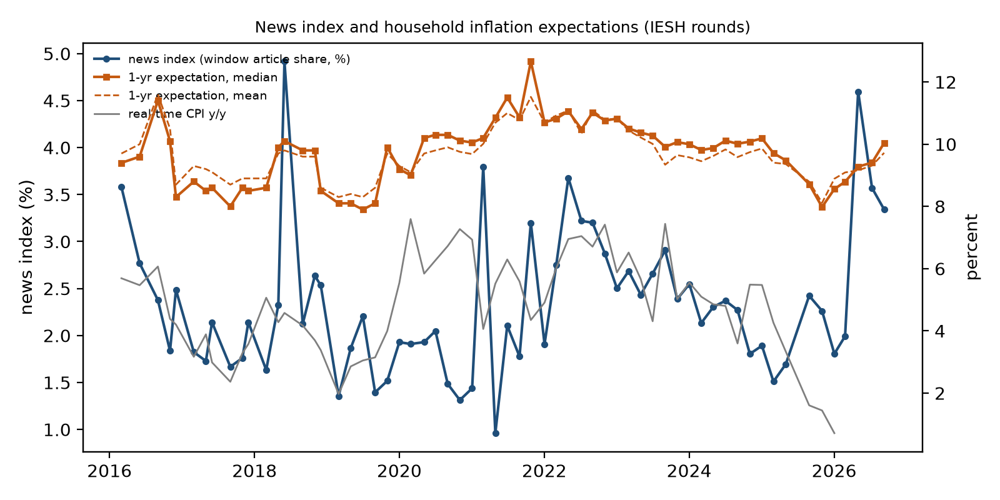
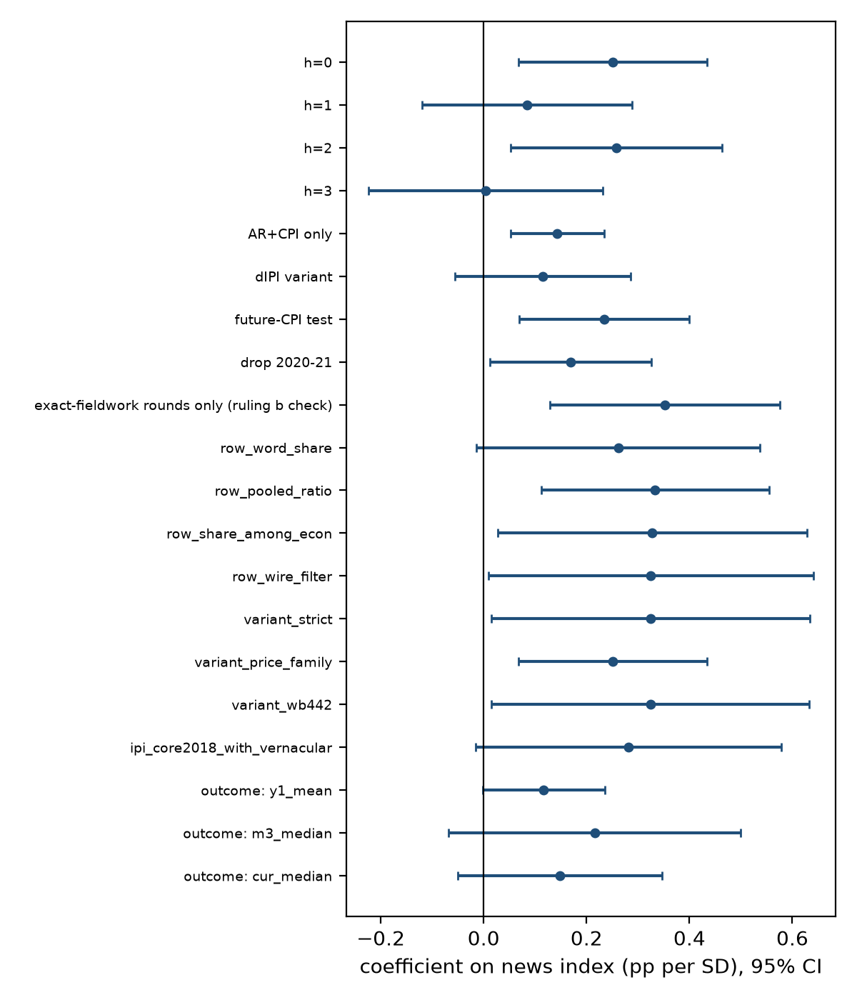

## Abstract

We build an open, reproducible index of news attention to inflation for India from the GDELT Global Knowledge Graph,
covering 104 English and vernacular outlets from 2016 to 2026, and measure it in the two weeks before each round of the
Reserve Bank of India's Inflation Expectations Survey of Households (IESH). The index is reliable (split-half
r = 0.89) and tracks Google searches for "inflation" (r = 0.54 to 0.78 across theme definitions), but it does not
peak in three of four pre-specified price episodes, and an audit of 1,250 sampled articles, coded twice by a large
language model with no human validation, finds that GDELT's inflation theme tags have low precision (0.16) and low
recall (0.30). Following a rule fixed before the audit, we switch to the broader "price family" definition and label
the index "audited, not externally validated". In 56 rounds, one standard deviation more attention is associated with
a 0.25 percentage-point higher change in the median one-year expectation, after real-time CPI and food inflation,
the repo rate and survey mode (95% CI 0.07 to 0.43; wild-bootstrap p = 0.058). The estimate depends on the control
set and the outcome, and the index adds nothing to a CPI-based forecast out of sample. We read the evidence as
suggestive and non-causal. The contribution is the measurement: an open pipeline, an audit of GDELT for the Indian
press, and a documented set of its limits.

## 1. Introduction

Household inflation expectations matter for monetary policy, and the IESH is the main measure of them in India. The
survey records what households expect but not what they read: the RBI's own discussion of the survey notes that it
does not capture households' exposure to media (Ruhi, Sharma and Sankaran 2025). News is one channel through which
households may learn about prices. Carroll (2003) models household expectations as updating slowly toward news-borne
professional forecasts; Lamla and Lein (2014) find that the volume and tone of German inflation news move consumers'
perceptions and expectations; Larsen, Thorsrud and Zhulanova (2021) show that news topics predict US household
expectations and that information rigidity varies with news coverage. For India, existing news-based measures use a
handful of English business dailies and dictionary sentiment, and target CPI or professional forecasts rather than
household expectations (Kishor and Pratap 2023; Pratap et al.; Banerjee, Kanodia and Ray 2019).

This paper makes three contributions, in decreasing order of weight. First, a measurement contribution: an open,
scripted index of news attention to inflation for India from GDELT, covering English and the main vernacular
languages, with every step reproducible from public data. Second, an audit of that measurement: GDELT's theme tags are
widely used but rarely checked against article text for non-US press. We sample 1,250 articles and code them with a
fixed codebook. Third, suggestive evidence on whether attention is associated with the IESH one-year expectation
beyond real-time prices. The design, the outcome, the specification and a switch rule for the index definition were
fixed in an analysis plan before any outcome regression was run; the audit was run after the first regressions, and
we report how that order affects interpretation (Section 6).

The headline is mixed and we report it as such. The index is reliable and tracks search interest, but the inflation
tag is imprecise, the index fails our pre-specified episode test, and the association with expectations is small,
sensitive to specification, and absent out of sample.

## 2. Data

**News.** GDELT GKG 2.0 records, for each online news article, the outlet, date, language and a set of machine-coded
themes (Leetaru and Schrodt 2013). We read two kinds of days: the 14 days ending the day before each IESH round's
fieldwork ("windows"), and a systematic one-in-four grid of all other days from January 2016 to October 2026 for a
monthly series. An independent recount of 147 days reproduced the extracted counts exactly. Outlets are restricted to
Indian domains (GDELT's domain-country file plus a documented review of 81 ambiguous domains), because foreign outlets
made up 29% of raw volume. GDELT has no data for 16 June to 1 July 2025, so the July 2025 round is dropped.

**Expectations.** The IESH reports national medians and means of urban households' current perceived inflation and
three-month and one-year-ahead expectations. We use rounds from March 2016 to September 2026. Responses are recorded
in 1-percentage-point bins, so the median moves in discrete steps. Before 2020 exact fieldwork dates are not always
published; we date those rounds to the first of the survey month and check that choice with an exact-date-only sample.

**Controls.** CPI (base 2012) headline and food inflation, taken in real time (the latest release before fieldwork);
the policy repo rate from RBI press releases; Brent crude; and a dummy for the telephone rounds of 2020–21.

**Search.** Google Trends for "inflation", "mehngai" and its Devanagari spelling, India, monthly. Trends rescales
every request; our plan averages three pulls on different days. At the time of writing one pull is available, so all
Trends numbers are provisional.

**Sample flow.** Of the 67 IESH rounds since 2015, 63 fall inside the news window file; 62 have a valid news window;
61 have the two earlier rounds needed for the lagged level and change of the expectation; 57 also have real-time CPI on
the 2012 base; and 56 have every control. The out-of-sample exercise starts after 20 rounds and evaluates 37 forecasts.

## 3. The index

For each outlet and window we compute the share of distinct articles carrying an inflation theme among all its
articles, then average the shares with equal weights over a balanced core of 104 outlets present in at least 80% of
windows (54 of them vernacular). Equal weights keep a few high-volume portals from dominating. Days with abnormally low
global or panel volume are dropped (9 of 1,654); a window needs 60% valid days.

Two definitions matter below. The *baseline* flag is GDELT's ECON_INFLATION theme. The *price family* adds the World
Bank inflation theme and GDELT themes for cost of living, price controls, price gouging, retail fuel, oil, electricity
and gas prices, transport costs and price subsidies. Both were defined before the audit.

**Scale and reliability.** Under the price-family definition the window index averages 2.33% of articles (SD 0.77
percentage points; maximum 4.92%). The baseline index is about half that level (mean 1.14%, SD 0.52 pp). Indices built
from odd and even days correlate at 0.89. Alternative constructions (word share, pooled ratio, share among economic
articles, wire-copy filter) correlate with the baseline at 0.93 to 1.00; the price family correlates at 0.72. The
monthly series uses grid days, pooled by source and language, and is on a different scale (peak 0.031 of articles in
June 2022), so window and monthly numbers should not be compared directly.

Table 1 describes the estimation sample and Figure 1 plots the index against expectations and CPI.

**Table 1. Estimation sample (56 IESH rounds), price-family index**

| Variable | Mean | SD | Min | Max |
|---|---|---|---|---|
| News index, window article share (%) | 2.22 | 0.69 | 0.96 | 4.92 |
| One-year expectation, median (%) | 9.75 | 1.05 | 7.90 | 12.66 |
| One-year expectation, mean (%) | 9.70 | 0.85 | 8.12 | 11.60 |
| Current perceived inflation, median (%) | 8.21 | 1.22 | 6.30 | 10.38 |
| Real-time CPI inflation (%) | 4.75 | 1.64 | 0.71 | 7.59 |
| Real-time food CPI inflation (%) | 4.66 | 3.98 | −3.91 | 13.63 |
| Change in repo rate (pp) | −0.01 | 0.24 | −0.75 | 0.90 |
| Telephone survey (share of rounds) | 0.11 | 0.31 | 0 | 1 |

## 4. Validation

### 4.1 Audit of the theme tags

We drew 1,250 articles from window days in eight strata: tagged and untagged economic articles in English and in
Hindi/Marathi and other vernaculars, non-economic articles whose web address contains a price word, and other
non-economic articles; 2015–18 were oversampled because of link rot. Texts were retrieved live or from the Internet
Archive for 89% of the sample (85% to 95% by stratum; 417 via the archive). The remaining 11% were coded from the
URL alone and are reported separately.

Each article was coded for relevance (does it discuss price levels or inflation affecting Indian consumers), direction
and stated cause, under a codebook fixed before coding. **There was no human coding.** By the author's ruling, coding
was done twice, in separate passes, by the same large language model (Claude), and the first pass is treated as the
truth. Agreement between passes was very high (relevance κ = 1.00 on 1,026 articles; direction 0.97; cause 0.94), but
two passes of one model are not independent coders, so this is reliability, not validation. From about the
550th article onward, for time and cost, the model coded from shorter excerpts (200–300 characters), which may
understate relevance for long articles.

Weighted to the sampled population, the baseline tag has precision 0.16 (95% CI 0.13 to 0.20) and recall 0.30
(0.20 to 0.47). Our pre-specified bar was precision ≥ 0.5 and recall ≥ 0.6; the tag fails both. Most tagged articles
are market, corporate or foreign-economy stories that mention prices in passing. Among the pre-specified alternatives,
the price family has the highest F2 (0.29 against 0.26 for the baseline), so by the plan's rule it becomes the primary
definition. No definition comes close to the precision bar. Recall in the vernacular strata (0.88) is far above
English (0.33), which suggests that GDELT's machine translation tags vernacular price stories more readily; the
English–vernacular comparison (Appendix A) is therefore a measurement result, not evidence on audiences.

### 4.2 External validation

The plan required the monthly index to correlate at least 0.5 with Google searches for "inflation" and to peak above
the 90th percentile of other months in at least three of four price episodes (onion 2019, fuel 2021, the period after
the Ukraine invasion in 2022, tomato 2023), with episode months fixed before inspection.

The price-family series correlates 0.54 with "inflation" searches (0.55 after removing CPI and food inflation;
block-bootstrap CI 0.31 to 0.75), and 0.78 with GDELT's own keyword-based DOC series. The baseline series correlates
0.78 with searches. Hindi-term searches correlate weakly (0.11 to 0.36). But only the 2022 episode peaks, for every
definition we tried; the onion, fuel and tomato episodes do not. The level of attention rose after 2022 and stayed
high, which raises the threshold for the earlier episodes. One of three placebo dates (the 2024 election results)
shows a peak in the daily baseline index.

The episode test therefore fails. The plan's rule was to try the best-F2 definition and then the strict flag, and, if
all failed, to label the index "audited, not externally validated" and treat the expectation tests as exploratory. All
failed, and that is the label we use. Two cautions apply to the correlations that did pass: they are levels of
persistent series, which is weak validation, and the Trends figures rest on one pull.

## 5. Specification

For round *t* we regress the change in the median one-year expectation between rounds *t−1* and *t+h* on the
standardised window index measured in the 14 days before round *t*'s fieldwork, controlling for the lagged level and
lagged change of the expectation, real-time CPI and food inflation, the change in the repo rate and the telephone-survey
dummy. The coefficient is the association, in percentage points, of one standard deviation more attention. Inference
uses equal-weighted cosine (EWC) standard errors with fixed-b critical values and a wild bootstrap. One cell was
designated primary in advance: one-year median, *h* = 0. Everything else is secondary.

## 6. Results

**Primary estimate.** Under the price-family index, one standard deviation more attention (0.77 percentage points of
articles) is associated with a 0.25 percentage-point higher change in the median one-year expectation (95% CI 0.07 to
0.43; wild-bootstrap p = 0.058; N = 56). Under the baseline tag, which the audit rejected, the same cell is 0.33
(0.015 to 0.64; p = 0.036). Because the median is recorded in 1-pp bins, an effect of 0.25 pp is best read as a shift
in the probability that the median moves up a bin, not as a continuous movement. For scale, the median's round-to-round
change has a standard deviation of 0.72 pp in the estimation sample, so the estimate is about a third of a typical
round-to-round move.

**Robustness.** Figure 2 and Table 2 report the variants. Three points stand out.

* *Controls matter.* With only the lagged expectation and headline CPI, the coefficient falls to 0.14 (0.05 to 0.23)
  under the price family and to 0.09 (−0.16 to 0.34) under the baseline. Adding food inflation, the repo rate and the
  survey-mode dummy raises it, so the estimate is conditional on that control set; we read this as specification
  dependence, not as evidence for either value.
* *Dropping 2020–21* (which also drops all telephone rounds, so the mode dummy is absent) gives 0.17 (0.01 to 0.33;
  p = 0.12): the point estimate shrinks and the interval widens. Under the baseline tag the point estimate is almost
  unchanged (0.30) and only the interval widens (−0.09 to 0.68).
* *Exact fieldwork dates only* (N = 32): 0.35 (0.13 to 0.58; p = 0.040); under the baseline 0.47 (0.12 to 0.83;
  p = 0.105).

Other outcomes are weaker: the mean one-year expectation 0.12 (−0.00 to 0.24; p = 0.054), the three-month median 0.22
(−0.07 to 0.50; p = 0.15), current perceptions 0.15 (−0.05 to 0.35; p = 0.11). At longer horizons the estimates
alternate in sign and size (*h* = 1: 0.08; *h* = 2: 0.26; *h* = 3: 0.00). The alternative index definitions give 0.25
to 0.33, with wild-bootstrap p between 0.02 and 0.07. Including next month's CPI (not known at fieldwork) leaves the
coefficient at 0.23.

**Table 2. Coefficient on the news index (pp per SD), one-year median, h = 0 unless stated**

| Specification | N | Price family | Baseline tag |
|---|---|---|---|
| Primary (pre-specified) | 56 | 0.25 [0.07, 0.43] p=0.058 | 0.33 [0.02, 0.64] p=0.036 |
| Lagged expectation + CPI only | 56 | 0.14 [0.05, 0.23] p=0.040 | 0.09 [−0.16, 0.34] |
| Drop 2020–21 | 46 | 0.17 [0.01, 0.33] p=0.115 | 0.30 [−0.09, 0.68] |
| Exact fieldwork dates only | 32 | 0.35 [0.13, 0.58] p=0.040 | 0.47 [0.12, 0.83] p=0.105 |
| Next-month CPI added | 55 | 0.23 [0.07, 0.40] p=0.035 | 0.30 [−0.06, 0.66] |
| Change in index | 55 | 0.12 [−0.06, 0.29] p=0.27 | 0.15 |
| Outcome: mean | 56 | 0.12 [−0.00, 0.24] p=0.054 | 0.25 p≈0.07 |

**Horse race with search.** In the same specification, Google searches for "inflation" alone give 0.10 (−0.07 to
0.28). With both regressors, the news index is 0.24 (0.04 to 0.43; p = 0.092) and searches 0.07 (−0.10 to 0.23).
The news index carries information that this search measure does not, but the Trends series is provisional.

**State dependence.** The association is larger when lagged CPI inflation exceeds 6% (interaction 0.18, 0.06 to 0.30;
p = 0.016; 14 high-inflation rounds), but the interaction disappears once 2020–21 is excluded (0.04, −0.26 to 0.33).

**Out of sample.** In a recursive pseudo-real-time exercise (37 forecasts), adding the index to an AR(1) model with CPI
and food inflation leaves the root mean squared error unchanged (ratio 1.00; Clark–West p = 0.10). Against a pure
AR(1) the model with the index is worse in RMSE (ratio 1.12) although the Clark–West test, which adjusts for
estimation noise in nested models, rejects equal accuracy (p = 0.036). We do not claim out-of-sample predictive
content.

**Multiple testing.** We report many estimates, and they are not independent: they share the outcome, the sample and
most regressors. Only one cell was designated primary. Under the definition the audit selected, that cell's
wild-bootstrap p-value is 0.058; under the rejected baseline it is 0.036. No correction is applied to the secondary
results, which should be read as descriptive. Given the failed validation, the plan treats all expectation results as
exploratory.

## 7. Limitations

1. **No human validation.** The audit relies on two passes of one language model; their agreement is not evidence of
   accuracy. Late batches were coded from short excerpts.
2. **Measurement.** The inflation tag is imprecise and the price family only slightly better; the index measures
   attention to price-related themes as GDELT tags them, not reading by households.
3. **Validation failed.** The index does not peak in most pre-specified episodes; the Trends comparison uses one pull.
4. **Order of work.** The plan was frozen before any outcome regression, but the first regressions (baseline tag) were
   run before the audit selected the price family. The switch followed the pre-specified rule; we report both.
5. **Small, persistent samples.** 56 rounds, overlapping fieldwork, binned medians, and a pandemic period with a
   change of survey mode.
6. **Coverage.** Urban households only; online outlets in GDELT; one-in-four grid days for the monthly series; a gap in
   mid-2025.
7. **No causal interpretation.** Attention may respond to the same price shocks households experience; controls for
   real-time CPI do not remove that.

## 8. Conclusion

GDELT can be turned into an open, reliable, bilingual index of news attention to inflation for India, and the index
tracks search interest. But GDELT's inflation tag captures many articles that are not about consumer prices and misses
most that are; the index does not reproduce known price episodes; and its association with household expectations is
small, sensitive to the control set and absent out of sample. The measurement and its documented limits are the
contribution. A human-coded audit, a text classifier in place of theme tags, and three Trends pulls are the obvious
next steps.

## References

Aarab, A. et al. (2025). ECB Economic Bulletin, Issue 6/2025 [title to be checked].
Arndt, S. (2024; 2026). Working papers on newspaper types and household inflation expectations [full reference to be checked].
Banerjee, S., Kanodia, A. and Ray, P. (2019). IIM Calcutta Working Paper Series No. 830 [title to be checked].
Carroll, C. D. (2003). Macroeconomic expectations of households and professional forecasters. Quarterly Journal of
Economics 118(1), 269–298.
Kishor, N. K. and Pratap, B. (2023). MPRA Paper No. 118951 [title to be checked].
Lamla, M. J. and Lein, S. M. (2014). The role of media for consumers' inflation expectation formation. Journal of
Economic Behavior & Organization 106, 62–77.
Larsen, V. H., Thorsrud, L. A. and Zhulanova, J. (2021). News-driven inflation expectations and information
rigidities. Journal of Monetary Economics 117, 507–520.
Leetaru, K. and Schrodt, P. A. (2013). GDELT: Global data on events, location, and tone, 1979–2012. ISA Annual
Convention.
Pratap, B., Ranjan, A., Kishore, V. and Bhoi, B. Reserve Bank of India Occasional Papers 42(2) [title and year to be
checked].
Ruhi, Sharma and Sankaran (2025). RBI Bulletin, July 2025 [title to be checked].

## Appendix A. Extensions (descriptive, baseline tag)

These were planned as extensions and are reported descriptively. They use the baseline tag because they were built
before the switch; given the failed validation, none is a test.

* **E1, city exposure.** Local articles assigned to 19 IESH cities by outlet edition paths are too few: the median
  window has 0 to 8 tagged local articles, so no city-level analysis is reported.
* **E2, English vs vernacular.** The English and vernacular monthly series correlate 0.91 (0.66 at the window level).
  Each alone gives about 0.26 in the primary specification; the vernacular index controlling for English gives 0.21
  (−0.05 to 0.46). Because vernacular recall in the audit is much higher than English recall, the comparison reflects
  how GDELT tags translated text as much as what outlets cover.
* **E3, salience basket.** A search-implied version (Trends item terms) shows no clear association. A media-implied
  version from GDELT DOC item counts was built, but its precision check was not completed.
* **E4, international framing.** The share of inflation articles that also carry international themes is
  uncorrelated with the index (0.01) and adds nothing (0.00, −0.21 to 0.21). The audit's agreement on international
  causes was too low (κ = 0.33) for claims.
* **E5, attention cycle.** Attention peaks in June 2022 (half-life about nine months), March 2025 and April 2026.
  Excess attention during disinflation is not associated with expectations (0.26, −0.16 to 0.68).

## Appendix B. Pipeline and reproducibility

All steps run from scripts in `09_ANALYSIS/pipeline/scripts`; design decisions are in `docs/design/` and the step log
in `PROGRESS.md`. BigQuery extraction used about 475 GB of a 670 GB budget in capped chunks. The analysis plan was
frozen (SHA-256 recorded) before outcome regressions. The audit codebook is hashed. Audit outputs are in
`outputs/audit/`; the switch decision in `data/processed/results/d9_switch.json`; switched-flag estimates in
`data/processed/results_switched/`. A scripted re-run (Gate 3) rebuilds the index from the cached extraction and
re-estimates the results; its report is in `data/processed/gate3/gate3_report.md`. Article texts are not
redistributed.
