## Abstract

We build an open, reproducible index of news attention to inflation for India from the GDELT Global Knowledge Graph:
a balanced core of 104 outlets (54 of them vernacular) drawn from a panel of 714 Indian domains, 2016–2026, measured
in the two weeks before each round of the Reserve Bank of India's household inflation expectations survey. Indices
built from alternate days correlate at 0.89, a sign of reliability rather than validity. An audit of 1,250 sampled
articles, coded twice by a large language model with no human coding, finds that GDELT's inflation tag has
precision 0.16 and recall 0.30. Under a rule fixed in advance we switch to a broader price-related theme family. That
index correlates 0.54 with Google searches for "inflation" (the original tag: 0.78), but correlations with Hindi
search terms are weak, and the index peaks in only one of four pre-specified price episodes, so we treat it as
audited but not externally validated and all expectation results as exploratory. In 56 survey rounds, one standard
deviation more attention is associated with a 0.25 percentage-point larger change in the median one-year
expectation after real-time inflation, the policy rate and survey mode (95% CI 0.07 to 0.43); the wild-bootstrap
p-value is 0.058, so the primary estimate does not clear the 5% level. The estimate depends on the control set and
the outcome, and the index does not improve a CPI-based forecast. Attention rises after oil-price increases. The
contribution is the measurement and its documented limits.

**Keywords:** inflation expectations; news attention; text data; GDELT; India; household surveys.
**JEL codes:** E31, E58, C55, C81, D84.

## 1. Introduction

Household inflation expectations are a central input to monetary policy. They enter wage and price setting, they
shape the credibility of an inflation target, and in India they have run well above both realised inflation and
professional forecasts for most of the inflation-targeting period. The Reserve Bank of India (RBI) measures them
through its Inflation Expectations Survey of Households (IESH). The survey records what urban households expect but
not what they read or hear: the RBI's own analysis of the survey notes that it does not capture households' exposure
to media and social interactions (Ruhi, Sharma and Sankaran 2025). News is one plausible channel through which
households learn about prices. This paper tries to measure it for India and to document how well the measurement
works.

The idea that households learn about inflation from the news is well established. Carroll (2003) models household
expectations as updating slowly toward professional forecasts reported in the news. Lamla and Lein (2014) show that
the volume and tone of inflation news move German consumers' perceptions and expectations. Larsen, Thorsrud and
Zhulanova (2021) find that news topics predict US household expectations and that information rigidity varies with
coverage. Aarab, Bańbura, Bobeica and Leguay (2025) build a news-attention-to-inflation indicator for the euro area
and show that it tracks consumers' perceived inflation, and Arndt (2024) finds that readers of different newspapers
in Germany hold different inflation perceptions. For India, Banerjee, Kanodia and Ray (2021) use text mining to study inflation expectations, and Pratap, Ranjan,
Kishore and Bhoi (2021) build news-based sentiment indicators to forecast food inflation. We are not aware of an
Indian news measure that covers vernacular outlets, which carry much of India's news readership, or that uses the
household survey as its outcome.

GDELT, which machine-codes themes for online news in many languages, offers a way to cover both, at the cost of
relying on dictionary-based theme tags whose accuracy for specific economic concepts outside the United States is
largely undocumented. That cost is the reason for the audit at the centre of this paper.

The paper makes three contributions, in decreasing order of weight.

1. **Measurement.** An open, scripted index of news attention to inflation for India, built from GDELT, covering
   English and nine Indian languages, with every step reproducible from public data under fixed design rules.
2. **An audit of the measurement.** We sample 1,250 articles in eight strata, retrieve their text, and code them
   under a fixed codebook to estimate the precision and recall of GDELT's inflation tags, by language and by the
   way the text was retrieved.
3. **Exploratory evidence on expectations.** We ask whether attention in the two weeks before a survey round is
   associated with the change in households' one-year expectation beyond real-time prices, and whether it improves
   out-of-sample forecasts.

The design, the primary outcome and specification, the validation tests and a rule for switching the index
definition were written into an analysis plan dated 17 November 2026, which was fixed (dated and hashed) before any
outcome regression was run. We refer to it below as "the analysis plan". The plan was not lodged in a public
registry, so we do not describe the study as pre-registered. The audit was completed after the first outcome
regressions; Section 9.11 explains how that order bears on interpretation.

**Preview of findings.** The index is reliable and tracks search interest for the English term, and monthly attention
rises after oil-price increases. But GDELT's inflation tag is imprecise and misses most relevant articles; the
broader theme family selected by the audit is only slightly better; the index fails the pre-specified episode test;
and the association with household expectations is small, sensitive to the control set and the outcome, at the edge
of the study's minimum detectable effect, and absent out of sample. We therefore present the index as a measurement
with documented limits, not as a validated predictor, and all expectation results as exploratory.

**Roadmap.** Section 2 reviews the literature and Section 3 the institutional background. Section 4 describes the
data and Section 5 the construction of the index. Section 6 reports the audit and Section 7 the external validation.
Section 8 sets out the specification and Section 9 the results, and Section 10 the extensions. Section 11 discusses
what an attention index can offer a central bank, Section 12 lists limitations and Section 13 concludes. Appendices
give theme lists, the outlet panel, the survey rounds, audit details, robustness tables and reproducibility notes.

## 2. Related literature

### 2.1 Household expectations and information

Households form inflation expectations with limited and costly information. Carroll (2003) shows that US household
expectations follow professional forecasts with a lag, consistent with households absorbing news slowly, and that
the lag shortens when inflation is in the news. Coibion, Gorodnichenko and Kamdar (2018) review the evidence from
survey expectations and document that household expectations are dispersed, biased upward and slow to adjust, which
makes the sources of household information a first-order question for policy.

A second strand measures the news directly. Lamla and Lein (2014) use German media content data and find that both
the intensity and the tone of inflation reporting move consumers' perceptions and expectations. Larsen, Thorsrud and
Zhulanova (2021) extract topics from a large newspaper corpus and show that inflation-related news predicts US
household expectations and helps explain information rigidity. Aarab et al. (2025) construct an indicator of
attention to inflation in euro-area news and show that it moves with consumers' perceived inflation and remained
elevated after inflation fell in 2023. Arndt (2024) links German survey respondents to the newspapers they read and
finds that perceptions differ systematically across newspaper types. Our index is closest in spirit to the attention
measure of Aarab et al. (2025), but built from an open global database rather than a licensed news archive, for a
multilingual press, and audited against article text.

### 2.2 Text-based inflation measures for India

The Indian literature using text to study inflation is small. Banerjee, Kanodia and Ray (2021) use text mining in an
exploratory study of Indian inflation expectations. Pratap, Ranjan, Kishore and Bhoi (2021)
construct news-based sentiment indicators and show that they help forecast food inflation. Neither uses the
household survey as its outcome, and we are not aware of Indian work that measures vernacular news coverage. Kishor and Pratap
(2023) study whether inflation targeting has anchored long-run inflation expectations in India, which provides
context for the persistence we find in household expectations.

### 2.3 The household survey

The IESH has been used to study the level, dispersion and determinants of Indian household expectations. Pattanaik,
Muduli and Ray (2019) ask whether household expectations influence wage and price dynamics in India. Ruhi, Sharma and
Sankaran (2025) describe trends and determinants of household expectations and the effect of monetary policy on them,
and note that the survey does not record media exposure. Our paper complements this work with an external measure of
the information environment in which the survey's respondents form expectations.

### 2.4 GDELT as a research source

GDELT (Leetaru and Schrodt 2013) records events, themes, tone and metadata for a very large share of online news
worldwide and is widely used in political science and, increasingly, in economics. Its themes are assigned by
dictionary matching, after machine translation for non-English text. Three limitations are well known: coverage
changes over time as sources are added or drop out; translation and dictionary matching can mis-tag; and the theme
taxonomy mixes concepts from different sources. Accuracy for specific economic concepts in non-Western presses is
rarely checked against article text. Our audit adds evidence on that question for one concept and one country, and
our design choices (a balanced outlet panel, article shares instead of counts, volume-based validity rules) respond
to the first limitation.

## 3. Institutional background

### 3.1 Inflation targeting in India

India adopted flexible inflation targeting in 2016. The target is 4% consumer price inflation with a tolerance band
of ±2 percentage points, and policy rates are set by a six-member Monetary Policy Committee constituted in 2016.
Headline CPI inflation has a large food component, so supply shocks to vegetables, pulses and edible oils move
measured inflation sharply, and administered prices for fuel and cooking gas move with government decisions as
well as global oil prices.

### 3.2 The household survey

The IESH asks households in large Indian cities (19 cities, about 6,000 households per round in recent years) for
their perception of current inflation and their expectations three months and one year ahead. It has been conducted
bimonthly since 2016. Responses are recorded in ranges of one percentage point; the RBI reports medians computed
from these grouped responses, interpolated within ranges, and means. The rounds of 2020–21 were conducted by
telephone because of the pandemic, and the survey's published documents do not always give exact fieldwork dates
before 2020.

### 3.3 Inflation episodes, 2016–2026

The period covers low inflation in 2017 and 2018–19, an onion-price spike in late 2019, a pandemic period with
food-price pressure and very high fuel taxes in 2020–21, a broad rise in 2022 after the invasion of Ukraine, a
tomato-price spike in mid-2023, and renewed oil-price pressure in 2025–26. The analysis plan fixed four of these
(onion 2019–20, fuel 2021, post-Ukraine 2022, tomato 2023) as validation episodes before the index was inspected
around them.

## 4. Data

### 4.1 News: the GDELT Global Knowledge Graph

GDELT's Global Knowledge Graph (version 2) records, for each online news article it ingests, the outlet, date,
language and a set of themes assigned by dictionary matching. We read two kinds of days.

* **Windows.** The 14 days ending the day before each survey round's fieldwork begins, read with the full set of
  fields. These give the round-level index.
* **Grid.** A systematic one-in-four sample of all other days from January 2016 to October 2026, read with fewer
  fields. These give a monthly series for validation and for the extensions.

The extraction ran on Google BigQuery in capped chunks under a fixed budget of 670 GB and used about 475 GB. An
independent recount of 147 days reproduced the extracted counts exactly (no mismatches on 53,335 cells defined by
source, day and language). GDELT has no Knowledge Graph data for 16 June to 1 July 2025, so the July 2025 round is
excluded.

### 4.2 Outlet panel

We keep Indian domains, identified from GDELT's domain-to-country file plus a documented manual review of 81
ambiguous domains. Foreign outlets made up 29% of raw volume and are excluded. Of 936 candidate domains, 714 remain,
covering about 70% of articles. The index uses a balanced core of 104 outlets present in at least 80% of windows
(Table 3; the list is in Appendix B).

**Table 3. Language of the 104 core outlets**

| Language | Outlets |
|---|---|
| English | 50 |
| Hindi | 23 |
| Tamil | 9 |
| Malayalam | 6 |
| Telugu | 4 |
| Marathi | 3 |
| Punjabi | 3 |
| Kannada | 3 |
| Gujarati | 2 |
| Bengali | 1 |

*Note:* language is the outlet's modal source language in GDELT's metadata.

### 4.3 Household expectations

We use the national medians and means of current perceived inflation and of three-month-ahead and one-year-ahead
expectations, for rounds from March 2016 to September 2026 (Appendix C lists them). For 26 rounds before 2020
without published exact dates we set the fieldwork start to the first day of the survey month; 37 rounds have exact
dates, and we check the date rule with an exact-date-only sample. Six rounds are identified as telephone rounds.

### 4.4 Prices, policy and markets

Headline and food CPI inflation (base 2012, from the statistics ministry's data service) are taken in real time: the
latest release available on the day before fieldwork begins. The policy repo rate comes from 74 RBI policy
decisions read from press releases. Brent crude (from FRED) enters the monthly analysis and one robustness row. The
analysis plan also listed retail pump prices as a control; no consistent series was available, so it was dropped.

### 4.5 Google Trends and the GDELT DOC interface

Google Trends gives monthly search interest in India for "inflation", "mehngai" (romanised Hindi for inflation) and
its Devanagari spelling, and for twelve item terms used in an extension. Trends rescales every request, and the
analysis plan averages three pulls taken on different days. Only one pull was taken, so every Trends number is
provisional. GDELT's DOC 2.0 interface gives keyword-based and theme-based article counts for Indian sources from
2017, used as a cross-check.

### 4.6 Sample flow

**Table 2. Sample flow**

| Step | Rounds |
|---|---|
| Survey rounds since 2015 | 67 |
| Inside the news window file (March 2016 onward, outage excluded) | 63 |
| With a valid news window | 62 |
| With the lagged level and change of the expectation | 61 |
| With real-time CPI on the 2012 base | 57 |
| With every control (estimation sample) | 56 |
| Out-of-sample forecasts evaluated (first: November 2019 round) | 37 |

## 5. Constructing the index

### 5.1 Definition

For each outlet and window we compute the share of distinct articles (web addresses deduplicated within a day)
carrying an inflation theme among all the outlet's articles, then average these shares with equal weights over the
core outlets. Equal weights keep a few high-volume portals from dominating; a volume-weighted version is reported as
a robustness check.

### 5.2 Theme definitions

All four definitions were fixed before the audit (Table 4; full codes in Appendix A).

**Table 4. Theme definitions**

| Definition | GDELT themes |
|---|---|
| Baseline | ECON_INFLATION |
| World Bank | WB_442_INFLATION |
| Strict | both of the above |
| Price family | the two inflation themes plus cost of living, price controls (two codes), price gouging and manipulation, retail fuel prices, gasoline and diesel prices, oil prices, electricity prices, natural-gas prices, transport costs and price subsidies (15 codes) |

GDELT assigns the World Bank theme alongside ECON_INFLATION almost every time, so the strict and World Bank
definitions are nearly identical to the baseline.

### 5.3 Validity rules

A day is invalid if its global volume or its panel volume falls below a fixed share of its centred 28-day median;
9 of 1,654 sampled days are invalid. A window needs at least 60% valid days; 62 of 63 pass.

### 5.4 Scale, reliability and variants

The window index is standardised over all rounds in the window file. Under the price family its mean is 2.33% of
articles and its standard deviation 0.77 percentage points (maximum 4.92%); in the 56-round estimation sample the
standard deviation is 0.69 (Table 1). The baseline index is about half that level (mean 1.14%, standard deviation
0.52 percentage points; minimum 0.36% in May 2021, maximum 2.16% in September 2022).

Indices built separately from odd and even days correlate at 0.89 (Spearman–Brown 0.94). This shows that the index
is measured with little sampling noise; it does not show that it measures attention to inflation. Duplicates across
days are 0.3% of articles and wire copies 3.6% of inflation articles. Table 5 shows that alternative constructions
move closely with the baseline; the price family is the only definition that differs materially.

**Table 5. Correlation of alternative constructions with the baseline window index**

| Construction | Correlation |
|---|---|
| Word share instead of article share | 0.93 |
| Pooled ratio instead of equal-weight average | 0.94 |
| Share among economic articles only | 0.96 |
| Wire-copy filter | 1.00 |
| Strict definition | 1.00 |
| 2018 core including vernacular outlets | 0.99 |
| Price family | 0.72 |

### 5.5 The monthly series

The monthly series uses grid days, pooled by outlet name and language without deduplication; 129 months are usable.
It is on a different scale from the window index: the baseline monthly series peaks at 3.1% of articles in June
2022, and the price-family monthly series peaks at 5.0% in April 2022 and 6.7% in April 2026 (Figure 2). It
correlates only modestly with CPI inflation: 0.31 contemporaneously (baseline), falling to about 0.1 at six-month
leads and lags.

**Table 1. Estimation sample (56 rounds), price-family index**

| Variable | Mean | SD | Min | Max |
|---|---|---|---|---|
| News index, window article share (%) | 2.22 | 0.69 | 0.96 | 4.92 |
| One-year expectation, median (%) | 9.75 | 1.05 | 7.90 | 12.66 |
| One-year expectation, mean (%) | 9.70 | 0.85 | 8.12 | 11.60 |
| Current perceived inflation, median (%) | 8.21 | 1.22 | 6.30 | 10.38 |
| Real-time CPI inflation (%) | 4.75 | 1.64 | 0.71 | 7.59 |
| Real-time food CPI inflation (%) | 4.66 | 3.98 | −3.91 | 13.63 |
| Change in repo rate (pp) | −0.01 | 0.24 | −0.75 | 0.90 |
| Telephone survey (share of rounds) | 0.11 | 0.31 | 0 | 1 |

*Note:* the regressions standardise the index over all rounds in the window file (SD 0.77 pp), not over this sample.
Medians are interpolated within 1-pp response ranges, hence the non-integer values.

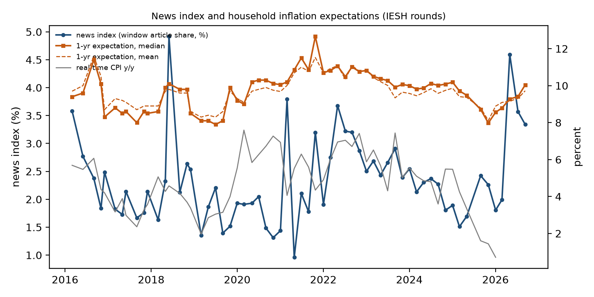

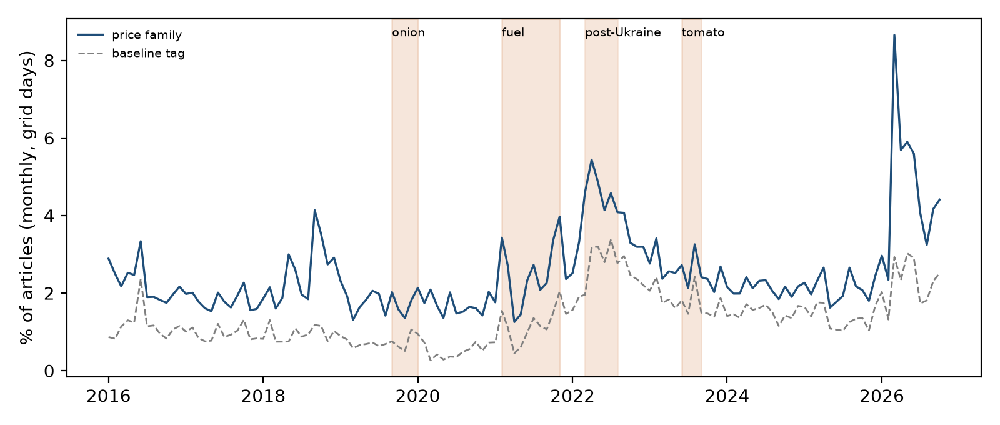

Expectations sit well above CPI inflation throughout. The index rises sharply in 2022, when both CPI and
expectations rose, and stays higher afterwards.

## 6. Auditing GDELT's inflation tags

### 6.1 Sample design

We drew 1,250 articles from window days in eight strata (Table 6): tagged and untagged economic articles in English,
in Hindi and Marathi, and in other vernaculars; non-economic articles whose web address contains a price word; and
other non-economic articles. The years 2015–18 were oversampled by a factor of 1.5 because older links are more often
dead. Sampling weights undo the stratification. The non-economic strata were drawn from a 19-day subsample and their
weights scaled up to all window days.

### 6.2 Retrieval

Texts were retrieved live or, failing that, from the Internet Archive's Wayback Machine (a snapshot within 30 days of
the article date). Of 1,250 articles, 1,113 (89%) were retrieved, 417 of them from the archive. Retrieval was lower
for older articles: by stratum and period it ranges from 0.74 (tagged English articles, 2015–18) to 0.99 (tagged
other-vernacular articles, 2019 onward; Appendix Table D1). Articles that could not be retrieved are not imputed; they
re-weight the coded articles in their stratum-by-period cell, which assumes that retrieval is unrelated to relevance
within a cell.

**Table 6. Audit sample and retrieval by stratum**

| Stratum | Sampled | Retrieved | Via archive | Rate |
|---|---|---|---|---|
| English, tagged | 300 | 256 | 104 | 0.85 |
| English, economic, untagged | 300 | 266 | 133 | 0.89 |
| Hindi/Marathi, tagged | 100 | 91 | 23 | 0.91 |
| Hindi/Marathi, economic, untagged | 100 | 90 | 31 | 0.90 |
| Other vernacular, tagged | 100 | 91 | 14 | 0.91 |
| Other vernacular, economic, untagged | 100 | 90 | 19 | 0.90 |
| Non-economic, price word in address | 150 | 142 | 57 | 0.95 |
| Non-economic, other | 100 | 87 | 36 | 0.87 |
| **Total** | **1,250** | **1,113** | **417** | **0.89** |

### 6.3 Codebook

Each article was coded for four items under a codebook fixed and hashed before coding (Appendix D):

* **relevance:** does the article substantially discuss price levels, inflation or the cost of living affecting
  consumers in India;
* **direction:** rising, falling, mixed or none;
* **primary and secondary cause:** domestic food supply, domestic fuel and energy, global oil and commodities,
  exchange rate, monetary policy, taxes and administered prices, wages and demand, corporate pricing, inflation abroad,
  or other/none;
* an **uncertainty** flag.

### 6.4 Coding protocol

**There was no human coding.** By design, coding was done twice, in separate passes, by the same large language model
(Claude), working through the articles inside an interactive session; the first pass is treated as the truth. The
coder saw only the article text and web address, never the stratum, the GDELT tags or the weights. The first pass
coded all 1,113 retrieved articles in a fixed order; the second coded the 1,026 articles in the strata that decide the
gating metrics, in a seeded random order within blocks. For the first 613 articles of the first pass and 610 of the
second, the coder saw excerpts of 800–1,100 characters; to reduce time and cost, later articles were coded from
excerpts of 200–300 characters, which may understate relevance for long articles.

Agreement between the two passes was very high: relevance κ = 1.00 on 1,026 articles; direction κ = 0.97 and cause
κ = 0.94 on the 118 articles that both passes coded as relevant. Two passes of one model are not independent coders,
so this agreement shows consistency of the model with itself, not accuracy.

### 6.5 Precision and recall

Precision is the share of tagged articles that are relevant; recall is the share of relevant articles that are
tagged; F2 weights recall twice as heavily as precision. All are weighted to the sampled population and computed in
the "gating frame" (economic articles plus non-economic articles with a price word in the address), with 95%
intervals from a stratified bootstrap. The analysis plan required precision of at least 0.5 and recall of at least
0.6.

**Table 7. Precision, recall and F2 by definition (gating frame, all languages; 95% CI)**

| Definition | Precision | Recall | F2 |
|---|---|---|---|
| Baseline | 0.16 (0.13, 0.20) | 0.30 (0.20, 0.47) | 0.26 (0.19, 0.35) |
| Price family | 0.13 (0.08, 0.19) | 0.42 (0.27, 0.64) | 0.29 (0.19, 0.41) |
| Strict | 0.16 (0.13, 0.20) | 0.29 (0.19, 0.45) | 0.25 (0.18, 0.34) |
| World Bank | 0.16 (0.13, 0.20) | 0.29 (0.19, 0.45) | 0.25 (0.18, 0.34) |

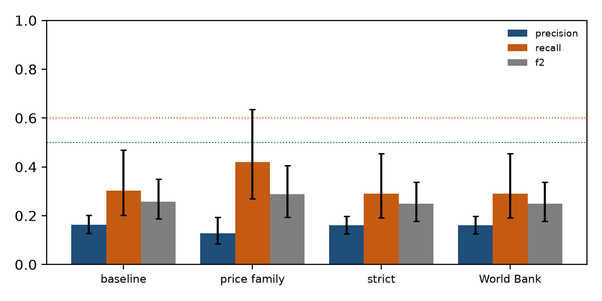

No definition comes close to the precision bar. The price family has the highest F2, trading lower precision for
higher recall, so under the analysis plan's switching rule it becomes the primary definition. Its intervals overlap
those of the baseline, so the choice is a rule-based one, not a clear statistical ranking.

**By language and retrieval mode.** Table 8 splits the estimates.

**Table 8. Precision, recall and F2 by group (gating frame; 95% bootstrap CI)**

| Group                  | Definition   | Coded / tagged / relevant   | Precision            | Recall               | F2                   |
|:-----------------------|:-------------|:----------------------------|:---------------------|:---------------------|:---------------------|
| All                    | Baseline     | 1,026 / 438 / 118           | 0.164 (0.128, 0.201) | 0.302 (0.202, 0.469) | 0.258 (0.188, 0.349) |
| All                    | Price family | 1,026 / 464 / 118           | 0.128 (0.084, 0.194) | 0.420 (0.270, 0.636) | 0.288 (0.194, 0.405) |
| English                | Baseline     | 566 / 231 / 51              | 0.136 (0.094, 0.179) | 0.291 (0.167, 0.543) | 0.237 (0.152, 0.357) |
| English                | Price family | 566 / 249 / 51              | 0.114 (0.061, 0.195) | 0.447 (0.249, 0.742) | 0.282 (0.166, 0.425) |
| Hindi/Marathi          | Baseline     | 181 / 91 / 22               | 0.240 (0.154, 0.331) | 1.000 (1.000, 1.000) | 0.612 (0.476, 0.712) |
| Hindi/Marathi          | Price family | 181 / 92 / 22               | 0.131 (0.057, 0.301) | 1.000 (1.000, 1.000) | 0.430 (0.232, 0.683) |
| Other Indian languages | Baseline     | 181 / 91 / 31               | 0.311 (0.223, 0.403) | 0.620 (0.379, 1.000) | 0.517 (0.352, 0.733) |
| Other Indian languages | Price family | 181 / 95 / 31               | 0.350 (0.198, 0.494) | 1.000 (1.000, 1.000) | 0.729 (0.552, 0.830) |
| All Indian languages   | Baseline     | 362 / 182 / 53              | 0.253 (0.184, 0.327) | 0.881 (0.732, 1.000) | 0.589 (0.477, 0.678) |
| All Indian languages   | Price family | 362 / 187 / 53              | 0.163 (0.080, 0.328) | 1.000 (1.000, 1.000) | 0.493 (0.303, 0.709) |
| Retrieved live         | Baseline     | 645 / 297 / 77              | 0.162 (0.120, 0.210) | 0.369 (0.223, 0.681) | 0.294 (0.198, 0.424) |
| Retrieved live         | Price family | 645 / 308 / 77              | 0.125 (0.085, 0.174) | 0.408 (0.246, 0.745) | 0.280 (0.192, 0.395) |
| Retrieved from archive | Baseline     | 381 / 141 / 41              | 0.167 (0.106, 0.233) | 0.229 (0.122, 0.490) | 0.213 (0.123, 0.367) |
| Retrieved from archive | Price family | 381 / 156 / 41              | 0.131 (0.056, 0.260) | 0.434 (0.194, 0.789) | 0.296 (0.137, 0.502) |

*Notes:* the "All" and "English" rows include the non-economic stratum with a price word in the address, whose
articles are in English. Recall of 1.000 with a degenerate interval means that no relevant article was found in the
sampled untagged strata of that language (90 articles each); it is not evidence of perfect recall.

Recall is much higher in the vernacular strata (0.88) than in English (0.33 in the economic frame), a gap of 0.55
(95% CI 0.20 to 0.76), far beyond the analysis plan's tolerance of 0.15. We describe this as differential theme
recall, possibly related to the machine translation applied to vernacular text before tagging; we cannot test the
mechanism. It means that comparisons of English and vernacular attention (Section 10.2) are measurement results.
Recall is lower for archived texts, which are older, but the live and archive intervals overlap almost completely
for both definitions.

**By coding batch.** Because excerpt length changed between batches and the later batches were mostly vernacular,
batch and language are confounded. In the economic frame, the early (long-excerpt, almost all English) batch gives
baseline precision 0.14 (0.09 to 0.19) and recall 0.46 (0.25 to 1.00) for English; the late (short-excerpt) batch gives
precision 0.16 (0.07 to 0.27) and recall 0.09 (0.03 to 0.95) overall. The late-batch intervals are too wide to say
whether short excerpts changed the codes.

### 6.6 The unscreened stratum and the address-only fallback

The non-economic articles without a price word in their address are outside the gating frame; they bound how many
relevant articles the frame misses. One of 87 coded articles in that stratum was relevant (exact 95% CI 0.000 to
0.062). Because that stratum is very large, even this low share implies that recall including it could be as low as
0.04, so the frame-based recall figures are upper bounds for the whole news flow.

For the 137 articles with no retrievable text, coding from the web address alone gives precision 0.13 (0.03 to 0.26)
and recall 0.56, with F2 0.34; only 7% of addresses were uninformative. Address coding is cruder than text coding and
is not used in any decision.

**Bounds for non-retrieval.** The estimates above assume that, within each stratum-by-period cell, retrieval is
unrelated to relevance. Table D2 replaces that assumption with the extremes for the 124 unretrieved articles in the
gating frame. If all of them were relevant, baseline precision would rise to 0.264 and recall fall to 0.094; if none
were, precision would be 0.146 and recall 0.299. Imputing the address-based codes gives 0.160 and 0.314. Under every
assumption precision stays far below 0.5 and recall below 0.6, for both definitions, and the price family keeps the
higher F2. The audit result does not depend on how the unretrieved articles are treated.

### 6.7 What the tags pick up

The audit codes do not classify irrelevant articles by type, so we cannot report counts of false-positive types; we
do not characterise them further. Among the 119 articles the first pass coded as relevant, 79 describe rising prices,
26 falling, 6 mixed and 8 no direction. The most common stated causes are domestic fuel and energy (26), taxes and
administered prices (24), domestic food supply (19) and global oil and commodities (9); 28 state no cause or another
one. Agreement between passes on
whether a cause was international was low (κ = 0.33 on 86 articles), so cause coding is not used for claims about
international framing.

### 6.8 The switching rule and its outcome

The analysis plan's rule was: if the baseline tag failed the precision and recall bar, switch to the pre-specified
definition with the highest F2; then validate it externally (Section 7); if it failed, try the strict definition; if
every candidate failed, keep the audited definition, label the index "audited, not externally validated", and treat
all expectation tests as exploratory. The baseline failed, the price family had the highest F2, and both the price
family and the strict definition failed external validation. The primary index is therefore the price family, with
that label. No threshold, definition or specification was changed after the results were seen.

## 7. External validation

The analysis plan required the monthly index (i) to correlate at least 0.5 with Google searches for "inflation", and
(ii) to peak above the 90th percentile of non-episode months in at least three of the four episodes. It also checked
three placebo dates (election results on 23 May 2019 and 4 June 2024, and the Cricket World Cup final on 19 November
2023), where a peak would suggest the index picks up general news volume.

**Table 9. External validation of the monthly index**

| Check | Baseline | Price family | Strict |
|---|---|---|---|
| Correlation with "inflation" searches | 0.78 | 0.54 | 0.78 |
| … partial, CPI and food inflation removed (95% CI) | 0.78 (0.65, 0.90) | 0.55 (0.31, 0.75) | – |
| … after linear trend and log volume removed | 0.67 | 0.41 | – |
| Correlation with "mehngai" searches | 0.26 | 0.11 | 0.26 |
| Correlation with Devanagari search term | 0.30 | 0.36 | 0.30 |
| Correlation with GDELT DOC keyword series | – | 0.78 | – |
| Correlation with GDELT DOC theme series | – | 0.77 | – |
| Onion 2019–20 (z; peak?) | −0.91, no | −0.72, no | −0.89, no |
| Fuel 2021 (z; peak?) | −0.36, no | −0.06, no | −0.35, no |
| Post-Ukraine 2022 (z; peak?) | 2.51, yes | 2.11, yes | 2.52, yes |
| Tomato 2023 (z; peak?) | 0.93, no | 0.22, no | 0.95, no |
| Episodes peaking (need ≥ 3 of 4) | 1 | 1 | 1 |

*Notes:* monthly series, 129 months (117 for the DOC comparison, which starts in 2017). Search correlations are raw
unless stated. Trends figures rest on one pull. z is the episode mean relative to non-episode months. The DOC
comparison was computed for the price-family series only.

**Search.** The English-term correlation passes for every definition. The Hindi-term correlations are weak for every
definition (0.11 to 0.36 raw), which may reflect search behaviour (Hindi speakers may search in English or not search
for the word) as much as the index.

**Episodes.** Only the 2022 episode peaks, for each of the three definitions tested (baseline, price family, strict);
the onion, fuel and tomato episodes do not. One possible explanation, which we have not tested, is that attention
rose after 2022 and stayed high, which raises the 90th-percentile threshold for the earlier episodes; another is that
those episodes were concentrated in a few items, while the index counts all price themes.

**Placebos.** In the daily baseline index, the window around the 2024 election results has a mean of 2.31% of
articles against a 90th percentile of 2.03% in the surrounding 60 days, so it counts as a peak; the 2019 election and
the 2023 cricket final do not. No survey-round window contains 4 June 2024, so this placebo peak does not enter the
round-level index.

**Matched construction.** The monthly series counts raw articles per outlet-day, while the round-level index uses
day-level distinct web addresses per host and a presence rule on the window total. To check that this difference does
not drive the validation result, we rebuilt a monthly series with the window construction (distinct addresses within
the day, ten-address presence rule, equal-weight mean over the 104 core outlets). The extraction kept distinct-address
counts only for survey-window days, so this series uses the grid days that fall inside windows: 68 months, 52 to 97
outlets per month, correlation 0.80 with the monthly series. It gives the same result (Table D4): one of four episodes
peaks (post-Ukraine), and the raw correlation with searches for "inflation" is 0.42, against 0.59 for the monthly
series on the same 68 months. A match on all grid days would require a new extraction.

**Conclusion of validation.** The episode test fails for every definition tested, so under the analysis plan the
index is "audited, not externally validated" and the expectation results below are exploratory. The correlations
that pass are correlations between levels of persistent series, which is weak validation, and the Trends evidence
rests on one pull.

## 8. Empirical specification

### 8.1 The local projection

For survey round $t$ and horizon $h \ge 0$ we estimate

$$\Delta^{h} y_{t} \equiv y_{t+h} - y_{t-1} = \alpha + \beta\, A_t + \gamma_1 y_{t-1} + \gamma_2 \Delta y_{t-1} + \delta' X_t + \varepsilon_{t},$$

where $y$ is the survey's median one-year expectation, $A_t$ is the window index in the 14 days before round $t$'s
fieldwork, standardised over all rounds, and $X_t$ contains real-time headline and food CPI inflation, the change in
the repo rate since the previous round, and the telephone-survey dummy (Jordà 2005). $\beta$ is the association, in
percentage points, of one standard deviation more attention. Including the lagged level and change of the expectation
absorbs its persistence: unit-root tests cannot reject a unit root in the median expectation (ADF p = 0.12; KPSS does
not reject stationarity), while the index is clearly stationary (ADF p < 0.001).

### 8.2 Timing

Real-time CPI is the latest release available on the day before fieldwork begins, so it is information households
could have had. The news window ends on the same day. A robustness row adds next month's CPI, which households could
not have known.

### 8.3 Inference

With 56 overlapping observations, standard errors use the equal-weighted cosine (EWC) estimator with fixed-b critical
values (Lazarus, Lewis, Stock and Watson 2018), and p-values come from a wild bootstrap. The intervals reported in
the tables are EWC fixed-b intervals; the p-values are wild-bootstrap p-values. In small samples the two can
disagree, for example an interval that just excludes zero alongside a p-value above 0.05. The analysis plan uses the
bootstrap p-value as the decision statistic.

### 8.4 The primary cell and secondary results

One cell was designated primary in advance: one-year median, $h = 0$. Everything else (other horizons, outcomes,
definitions and specifications) is secondary. For forecasting we use a recursive pseudo-real-time exercise and the
Clark and West (2007) test for nested models.

### 8.5 Deviations from the analysis plan

Two deviations are disclosed. The planned retail pump-price control was dropped because no consistent series
exists; Brent crude enters only as a robustness row. The plan called for three Trends pulls; one was taken.

## 9. Results

### 9.1 Primary estimate

Under the price-family index, one standard deviation more attention (0.77 percentage points of articles) is associated
with a 0.25 percentage-point larger change in the median one-year expectation (95% CI 0.07 to 0.43; wild-bootstrap
p = 0.058; N = 56). The estimate does not clear the 5% level on the decision statistic. Under the baseline tag, which
the audit rejected, the same cell is 0.33 (0.02 to 0.64; p = 0.036).

For scale, the change in the median has a standard deviation of 0.72 percentage points in the estimation sample, so
the estimate is about a third of a typical round-to-round move. The median is interpolated within 1-pp response
ranges, so it moves in small steps, but its changes are coarse; we read the coefficient as an average shift, not a
precise continuous response.

**Power.** With 6 fixed-b degrees of freedom and the primary standard error, the minimum effect detectable with 80%
power at the 5% level is 0.25 percentage points per standard deviation, the same size as the estimate. The study is
powered only for effects of this size or larger.

### 9.2 Robustness

Table 10 reports the main variants for both definitions, and Figure 3 plots them.

**Table 10. Coefficient on the news index (pp per SD), one-year median, h = 0 unless stated**

| Specification | N | Price family | Baseline tag |
|---|---|---|---|
| Primary (specified in advance) | 56 | 0.25 [0.07, 0.43] p=0.058 | 0.33 [0.02, 0.64] p=0.036 |
| Lagged expectation + headline CPI only | 56 | 0.14 [0.05, 0.23] p=0.040 | 0.09 [−0.16, 0.34] p=0.37 |
| Brent added | 56 | 0.24 [0.07, 0.42] p=0.062 | 0.35 [0.02, 0.68] p=0.042 |
| Drop 2020–21 | 46 | 0.17 [0.01, 0.33] p=0.115 | 0.30 [−0.09, 0.68] p=0.130 |
| Exact fieldwork dates only | 32 | 0.35 [0.13, 0.58] p=0.040 | 0.47 [0.12, 0.83] p=0.105 |
| Next-month CPI added | 55 | 0.23 [0.07, 0.40] p=0.035 | 0.30 [−0.06, 0.66] p=0.054 |
| Change in index instead of level | 55 | 0.12 [−0.06, 0.29] p=0.272 | 0.15 [−0.16, 0.45] p=0.411 |
| Outcome: one-year mean | 56 | 0.12 [−0.00, 0.24] p=0.054 | 0.25 [−0.04, 0.54] p=0.072 |
| Presence threshold 60% (180 outlets) | 56 | 0.30 [0.09, 0.51] p=0.023 | – |
| Presence threshold 90% (65 outlets) | 56 | 0.28 [0.10, 0.46] p=0.031 | – |
| Volume-weighted (104 outlets) | 56 | 0.34 [0.15, 0.53] p=0.010 | – |
| Placebo outcome: previous change | 56 | 0.09 [−0.20, 0.39] p=0.50 | – |

*Notes:* EWC fixed-b 95% intervals in brackets; wild-bootstrap p-values. Controls as in Section 8 unless stated.
Construction variants of the baseline index are in Appendix E.

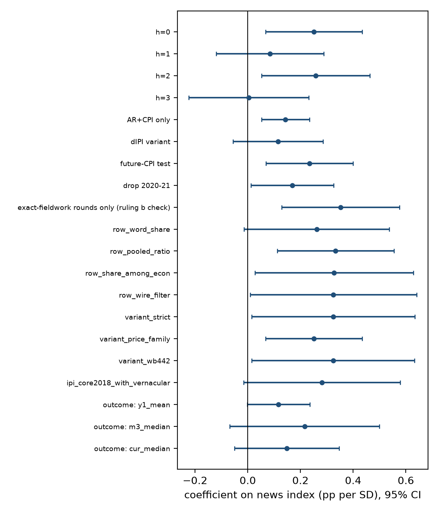

Five points stand out.

* **Controls matter.** With only the lagged expectation and headline CPI, the coefficient falls to 0.14 under the
  price family and 0.09 under the baseline. Adding food inflation, the repo rate and the survey-mode dummy raises it.
  The estimate is conditional on the control set; we read this as specification dependence, not as evidence for
  either value.
* **The pandemic rounds.** Dropping 2020–21 also drops all telephone rounds, so the mode dummy falls out. Under the
  price family the estimate shrinks to 0.17 and the interval widens; under the baseline the point estimate is almost
  unchanged (0.30) and only the interval widens.
* **Dating.** Rounds with exact fieldwork dates (N = 32) give larger estimates, 0.35 and 0.47, with wide intervals.
* **Construction.** Changing the presence threshold to 60% or 90%, or weighting outlets by volume, gives 0.28 to 0.34
  with bootstrap p-values from 0.010 to 0.031, so the equal-weight 80% core is not driving the result. Excluding the
  2024 election window changes nothing, because no survey window contains it.
* **Placebo outcome.** Attention before round $t$ is not associated with the previous change in expectations (0.09,
  −0.20 to 0.39), as expected if the association is not simply picking up trends in expectations. Adding next
  month's CPI leaves the coefficient at 0.23, so the association is not just anticipation of the next CPI print.
* **Further checks (Appendix Tables E4 to E7).** Adding a linear trend, the change in the rupee–dollar rate, or a
  post-2022 dummy with its interaction leaves the coefficient between 0.235 and 0.284. The interaction is −0.273
  (p = 0.052), so the association before 2022 accounts for the estimate and the slope after 2022 is close to zero;
  the subsamples before and after 2022 (N = 32 and 24) give 0.255 and 0.105, both imprecise. Windows of the last
  ten or seven days before fieldwork give 0.293 and 0.260 (p = 0.058 and 0.059). Between 84 and 103 of the 104
  core outlets contribute to each window (median 97.5); restricting to windows with at least the median gives 0.192
  (p = 0.019, N = 30), and balanced panels of the 37 or 44 outlets present in every window give 0.352 and 0.346
  (p = 0.012 and 0.009). None of these changes the reading: the estimate is positive and of similar size, and it
  clears the 5% level only in subsets or alternative panels that were not specified in advance.

### 9.3 Horizons and outcomes

Table 11 and Figure 4 report all four expectation measures at horizons of zero to three rounds.

**Table 11. Coefficient on the news index by outcome and horizon (price family; 95% CI)**

| Outcome | h = 0 | h = 1 | h = 2 | h = 3 |
|---|---|---|---|---|
| One-year median | 0.25 (0.07, 0.43) | 0.08 (−0.12, 0.29) | 0.26 (0.05, 0.46) | 0.00 (−0.22, 0.23) |
| One-year mean | 0.12 (−0.00, 0.24) | 0.06 (−0.13, 0.26) | 0.18 (0.03, 0.34) | 0.02 (−0.22, 0.26) |
| Three-month median | 0.22 (−0.07, 0.50) | 0.16 (−0.07, 0.39) | 0.23 (−0.01, 0.47) | −0.03 (−0.22, 0.15) |
| Current perception, median | 0.15 (−0.05, 0.35) | 0.25 (−0.11, 0.61) | 0.26 (0.03, 0.50) | 0.01 (−0.31, 0.32) |

*Note:* wild-bootstrap p-values at h = 0: 0.058, 0.054, 0.146 and 0.108.

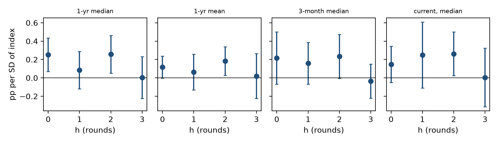

Beyond h = 0 the estimates are smaller and imprecise at h = 1 and h = 3 and larger at h = 2; the profile is uneven
rather than a smooth dynamic response, which is what noise in a short sample with overlapping changes would produce.
The mean expectation responds about half as much as the median.

### 9.4 Horse race with search

**Table 12. Horse race with Google searches for "inflation" and state dependence (one-year median, h = 0)**

| Regression | Coefficient | 95% CI | p (bootstrap) |
|---|---|---|---|
| News index alone | 0.25 | (0.07, 0.43) | 0.058 |
| Search alone | 0.10 | (−0.07, 0.28) | 0.244 |
| News index, with search | 0.24 | (0.04, 0.43) | 0.092 |
| Search, with news index | 0.07 | (−0.10, 0.23) | 0.395 |
| Index × (lagged CPI > 6%) | 0.18 | (0.06, 0.30) | 0.016 |
| Index × (CPI − 4) | 0.12 | (0.03, 0.22) | 0.062 |
| Index × (lagged CPI > 6%), excluding 2020–21 | 0.04 | (−0.26, 0.33) | 0.776 |

With both regressors, the news index keeps its size and the search coefficient shrinks. This is consistent with the
news index containing information that this search measure does not, but the evidence is weak: the news index's
bootstrap p-value is 0.092 and the Trends series rests on one pull.

### 9.5 State dependence

The association is larger when lagged CPI inflation exceeds 6% (14 high-inflation rounds): the interaction is 0.18
(p = 0.016). Leaving out each of the seven high-inflation episodes in turn gives interactions from 0.16 to 0.27, but
the intervals of three of the seven include zero (Appendix Table E2). Excluding 2020–21 removes the interaction
(0.04), so it rests largely on the pandemic rounds.

### 9.6 VAR impulse responses

A small Bayesian VAR in Brent, CPI, the index, the median expectation and the repo rate (58 rounds, two lags) gives
small responses of the expectation to an index shock (Figure 5). With the index ordered before expectations the
response is 0.09 percentage points on impact, falling to about zero by the fourth round and slightly negative after
five. With expectations ordered first the impact response is zero by construction and later responses range from
−0.06 to 0.02. The ordering drives the impact response, so the VAR adds little beyond the local projections.

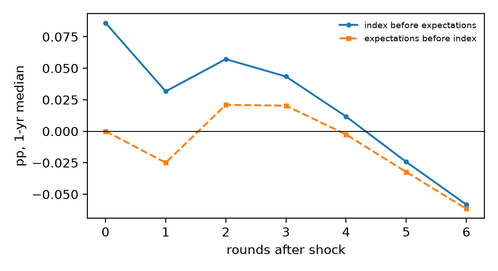

### 9.7 Out-of-sample forecasts

**Table 13. Pseudo-real-time forecast evaluation (37 forecasts, November 2019 to September 2026)**

| Benchmark | Definition | RMSE ratio (model with index / benchmark) | 95% CI | Clark–West p |
|---|---|---|---|---|
| AR(1) + CPI + food | Price family | 1.00 | (0.95, 1.07) | 0.100 |
| AR(1) | Price family | 1.12 | (0.87, 1.55) | 0.036 |
| AR(1) + CPI + food | Baseline | 1.03 | (0.98, 1.12) | 0.685 |
| AR(1) | Baseline | 1.17 | (0.92, 1.60) | 0.045 |

Adding the index to an AR(1) model with CPI and food inflation leaves the root mean squared error unchanged. Against
a pure AR(1), the model with the index (which also contains CPI and food inflation) has a higher RMSE, although the
Clark–West test, which adjusts for estimation noise in nested models, rejects equal accuracy. We do not claim
out-of-sample predictive content. Figure 6 shows the forecast errors.

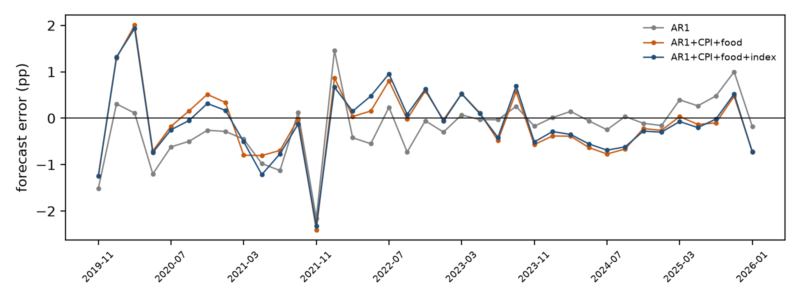

### 9.8 What moves the index

Monthly local projections of the standardised monthly index on price shocks show that attention responds to oil
prices but not to CPI surprises. A one per cent rise in Brent is followed by 0.016 to 0.020 standard deviations more
attention in the same and next two months (about 0.16 to 0.20 standard deviations for a 10% rise), with intervals
excluding zero at several horizons up to nine months. A one-point surprise in CPI inflation, relative to a recursive
autoregressive forecast, is followed by responses between −0.04 and 0.14 standard deviations, none distinguishable
from zero (Appendix Table E3). News attention in India appears to follow visible fuel-price pressure more than
surprises in the headline index. Joint tests that all thirteen responses (h = 0 to 12) are zero do not reject for either shock:
the block-bootstrap p-value is 0.926 for CPI surprises and 0.203 for Brent, and the Bonferroni bound on the smallest
Brent p-value is 0.121 (Table E7). The individual Brent responses should therefore be read as suggestive.

### 9.9 Persistence

The median one-year expectation is highly persistent (ADF p = 0.12; KPSS does not reject stationarity), and the index
is stationary (ADF statistic −5.95, p < 0.001; KPSS 0.19). The specification in changes with lagged levels is designed
for this combination; the placebo-outcome test in Section 9.2 is a check against spurious association from trends.

### 9.10 Multiple testing

The paper reports 84 estimated coefficients or test statistics from the main analysis (42 local projections, 10
state-dependence rows, 2 forecast comparisons, 26 monthly responses and 4 horse-race rows), plus the robustness and
extension rows, and 25 further robustness rows and joint tests in Appendix Tables E4 to E7. They are not independent: they share the outcome, the sample and most regressors. Only one cell was
designated primary, and its bootstrap p-value is 0.058 under the definition the audit selected (0.036 under the
rejected baseline). We do not apply a multiplicity correction to the secondary results, which should be read as
descriptive; given the failed validation, the analysis plan treats all expectation results as exploratory.

### 9.11 Order of work

The analysis plan was fixed before any outcome regression, but the first outcome regressions used the baseline tag
and were run before the audit was complete. The audit then selected the price family under the rule fixed in the
plan, and the analysis was re-run with it. Because the switch followed a rule that did not depend on the regression
results, and because we report both definitions throughout, the order does not allow the definition to be chosen for
its results; but the reader should know that the baseline results were seen first.

## 10. Extensions

The analysis plan listed five extensions, each with its own condition for supporting inferential claims. All are
reported descriptively. Unless stated, they use the price-family index; baseline versions are in Appendix F.

### 10.1 City exposure

We assigned local articles to the survey's 19 cities using outlet edition paths in web addresses (for example a city
section of a national portal), intending to relate city-level attention to city-level expectations. The condition
for analysis was enough tagged local articles per city and window. It fails in every year (Table 14): the median
window has between 0 and 8 tagged local articles depending on the city, only 10 of 209 city-years meet the
descriptive threshold (Mumbai, Delhi and Chandigarh) and none meets the inferential one. Tagged articles are 0.1% to
0.9% of local articles. No city-level estimate is reported.

**Table 14. City exposure, by city (baseline tag, 2016–2026)**

| City               |   Median local articles per window |   Median tagged per window |   Max tagged |   City-years meeting descriptive threshold |   Tagged share (%) |
|:-------------------|-----------------------------------:|---------------------------:|-------------:|-------------------------------------------:|-------------------:|
| Mumbai             |                             1947   |                        8   |         14.5 |                                          5 |               0.52 |
| Delhi              |                             1778   |                        5.5 |         19   |                                          4 |               0.53 |
| Chandigarh         |                              703   |                        1.5 |         11.5 |                                          1 |               0.64 |
| Bengaluru          |                              537.5 |                        1   |          2.5 |                                          0 |               0.23 |
| Lucknow            |                              507   |                        3.5 |          8.5 |                                          0 |               0.82 |
| Kolkata            |                              495   |                        0   |          2   |                                          0 |               0.16 |
| Patna              |                              369   |                        2.5 |          4.5 |                                          0 |               0.71 |
| Chennai            |                              322.5 |                        0   |          1   |                                          0 |               0.11 |
| Hyderabad          |                              312   |                        0   |          0.5 |                                          0 |               0.11 |
| Ranchi             |                              281.5 |                        1   |          7   |                                          0 |               0.64 |
| Ahmedabad          |                              261   |                        0.5 |          2   |                                          0 |               0.47 |
| Jaipur             |                              226.5 |                        1   |          9.5 |                                          0 |               0.87 |
| Bhopal             |                              223.5 |                        1   |          3.5 |                                          0 |               0.6  |
| Bhubaneswar        |                              206   |                        0   |          0   |                                          0 |               0.13 |
| Nagpur             |                              184   |                        1   |          3   |                                          0 |               0.66 |
| Jammu              |                              152.5 |                        0   |          1   |                                          0 |               0.37 |
| Guwahati           |                              127   |                        0   |          0.5 |                                          0 |               0.21 |
| Thiruvananthapuram |                               60   |                        0   |          0   |                                          0 |               0.11 |
| Raipur             |                               52   |                        0   |          1   |                                          0 |               0.86 |

### 10.2 English versus vernacular attention

The English and vernacular monthly series move closely together: their correlation is 0.91 at lag zero and falls to
about 0.5–0.6 at six-month leads and lags in either direction, with no sign that one leads the other (Table 15,
Figure 7). At the window level they correlate 0.66. In the primary specification each alone gives about 0.26 (English
0.26, 0.01 to 0.50; vernacular 0.26, 0.03 to 0.50); the vernacular index controlling for English gives 0.21 (−0.05
to 0.46; p = 0.090). The analysis plan required English and vernacular recall to be within 0.15 of each other before
treating this comparison as evidence about audiences. The gap is 0.55, so the comparison is a measurement result: it
reflects how GDELT tags translated text as much as what outlets cover. The language split is built from the baseline
tag; no price-family language split was constructed.

**Table 15. Correlation of vernacular and English monthly attention at leads and lags (positive: vernacular later)**

|   Lag (months) |   Correlation |   N |
|---------------:|--------------:|----:|
|             -6 |         0.632 |  99 |
|             -5 |         0.677 | 100 |
|             -4 |         0.7   | 101 |
|             -3 |         0.739 | 102 |
|             -2 |         0.78  | 103 |
|             -1 |         0.797 | 104 |
|              0 |         0.905 | 105 |
|              1 |         0.752 | 104 |
|              2 |         0.716 | 103 |
|              3 |         0.671 | 102 |
|              4 |         0.633 | 101 |
|              5 |         0.578 | 100 |
|              6 |         0.499 |  99 |

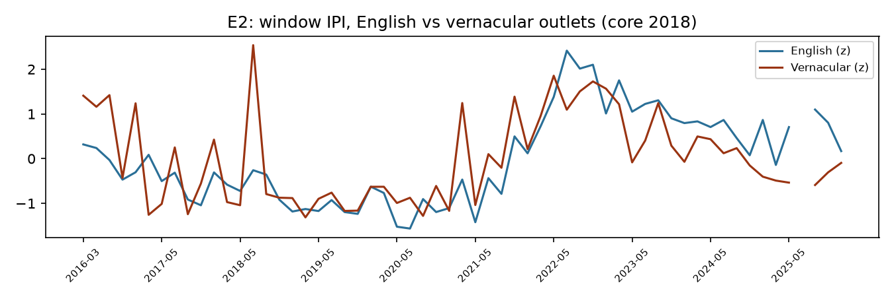

### 10.3 Salience basket

The idea was to weight item-level price changes by how much attention each item gets, giving a "salience-weighted"
inflation rate that households might perceive. We mapped twelve search terms (onion, tomato, potato, petrol, diesel,
gas cylinder, milk, dal, atta, rice, edible oil and gold prices) to CPI items and built a search-implied version from
Google Trends. In a horse race with published CPI inflation it shows no association (Table 16; Figure 10). A
media-implied version from GDELT DOC item counts was built, but its precision check was not completed, so it is not
reported. This extension does not use the news index, so it is the same under both definitions.

**Table 16. Salience basket horse race (one-year median, h = 0; search-implied version)**

| Regression                                                            |   N |   Coefficient |   CI low |   CI high |     p |
|:----------------------------------------------------------------------|----:|--------------:|---------:|----------:|------:|
| horse race coefficient on salience-weighted median                    |  54 |        -0.006 |   -0.019 |     0.007 | 0.428 |
| horse race coefficient on published CPI                               |  54 |         0.102 |   -0.075 |     0.279 | 0.267 |
| horse race coefficient on absolute salience-weighted                  |  54 |        -0.002 |   -0.008 |     0.005 | 0.573 |
| salience-weighted median alone [trends_search_implied]                |  54 |        -0.008 |   -0.014 |    -0.003 | 0.04  |
| corr(salience-weighted median, published CPI) [trends_search_implied] |  55 |        -0.124 |          |           |       |

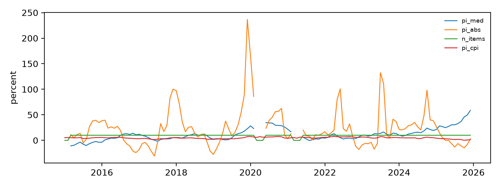

### 10.4 International framing

We measured the share of inflation articles that also carry international themes (foreign economies, global
commodities, exchange rates), to ask whether internationally framed inflation news relates to expectations
differently. The analysis plan allowed regression claims only if the audit's agreement on international causes reached
0.6; it is 0.33. We therefore report this extension descriptively: the international share is uncorrelated with the
baseline index (0.01) and weakly correlated with the price-family index (0.28) (Figure 8). We do not interpret the
regressions computed for it, which are listed in Appendix F for completeness.

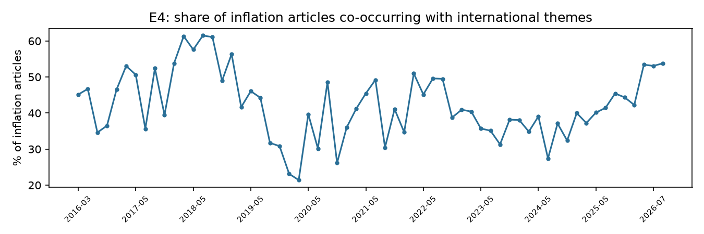

### 10.5 The attention cycle

Monthly price-family attention has four identified peaks (Table 17, Figure 9), the largest in April 2022 and April
2026. Peaks rise over one to three months and decay with half-lives of one to seven months; the baseline series gives
peaks in June 2022 (half-life nine months), March 2025 and April 2026. Excess attention during disinflation, defined
in the analysis plan as attention above what CPI predicts when inflation is falling, is not associated with
expectations (0.29, −0.03 to 0.61; p = 0.18). With only 56 rounds this null is underpowered and says little.

**Table 17. Peaks in monthly attention (price family)**

| Peak month   |   Peak (% of articles) |   Prior 12-month level (%) |   Months of rise |   Half-life (months) |
|:-------------|-----------------------:|---------------------------:|-----------------:|---------------------:|
| 2016-05      |                   2.78 |                       2.39 |                1 |                    1 |
| 2018-10      |                   3.47 |                       1.67 |                3 |                    3 |
| 2022-04      |                   4.97 |                       1.68 |                3 |                    7 |
| 2026-04      |                   6.75 |                       1.78 |                3 |                    4 |

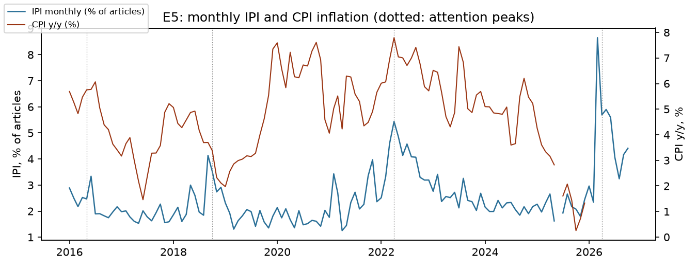

## 11. Discussion

**What an attention index can tell a central bank.** An attention index measures how much of the news flow is about
prices, not what households read or believe. Its value for a central bank is as a timely, cheap indicator of the
information environment between survey rounds, and as a way to ask whether expectations move more when prices are in
the news. Our results give modest support to the first use (the index tracks English-term search interest and
responds to oil prices) and only exploratory, specification-dependent evidence on the second.

**Comparison with the euro-area attention indicator.** Aarab et al. (2025) report that euro-area news attention to
inflation rose sharply in 2022 and stayed elevated after inflation fell. Our Indian index shows the same 2022 rise and
persistence. That persistence is also one possible reason our episode test fails: when the general level of
attention shifts, fixed percentile thresholds no longer pick out shorter item-specific episodes.

**Using GDELT for Indian and vernacular press.** GDELT makes multilingual coverage feasible at low cost, and the
index built from it is internally reliable. But its inflation tag is imprecise, and recall differs sharply between
English and vernacular text. Anyone using GDELT themes for economic concepts in India, or comparing languages, should
audit the tags first. A supervised text classifier trained on a human-coded sample would likely improve both
precision and recall.

## 12. Limitations

1. **No human validation.** The audit relies on two passes of one language model. Their agreement shows the model's
   consistency with itself, not accuracy, and later batches were coded from short excerpts. A human-coded subsample
   of at least 100 articles is the most important missing check.
2. **Imprecise measurement.** The inflation tag has precision 0.16 and recall 0.30; the price family is only slightly
   better. The index measures price-related themes as GDELT tags them, not household reading. Recall differs sharply
   by language, and the recall figures are upper bounds for the whole news flow. Treating the unretrieved articles as all relevant or all
   irrelevant does not change this.
3. **Failed external validation.** The index peaks in one of four pre-specified episodes for every definition tested.
   The Trends comparison uses one pull instead of three, and the Hindi-term correlations are weak. Rebuilding the
   monthly series with the round-level construction gives the same result.
4. **Order of work.** The first outcome regressions used the baseline tag and were run before the audit selected the
   price family. The switch followed a rule fixed in advance, and both definitions are reported.
5. **Small sample and low power.** 56 rounds, overlapping fieldwork, medians computed from grouped responses, and a
   minimum detectable effect equal to the estimate. The primary estimate does not clear the 5% level.
6. **Specification dependence.** The estimate roughly halves with a minimal control set and shrinks when the
   pandemic rounds are dropped. The association is concentrated before 2022; the slope after 2022 is close to zero.
7. **Coverage.** Urban households in large cities only; online outlets in GDELT only; one-in-four grid days for the
   monthly series; the July 2025 round lost to a GDELT outage; six telephone rounds in 2020–21; pre-2020 fieldwork
   dates set by rule for 26 rounds.
8. **Deviations from the plan.** The pump-price control was dropped for lack of data; one Trends pull instead of
   three; the media-implied salience version was not completed; the English–vernacular split exists only for the
   baseline tag.
9. **No benchmark comparison.** We do not compare the index with existing Indian news-based inflation measures or
   with an economic-policy-uncertainty-style newspaper count, because neither was available to us in comparable
   form.
10. **No causal interpretation.** Attention may respond to the same price shocks households experience, as the
    oil-price responses suggest; controlling for real-time CPI does not remove that.

## 13. Conclusion

GDELT can be turned into an open, reliable, multilingual index of news attention to inflation for India. The index
tracks English-term search interest and responds to oil prices. But GDELT's inflation tag captures many articles that
are not about consumer prices and misses most that are; the index does not reproduce known price episodes; and its
association with household expectations is small, sensitive to the control set, at the edge of what the sample can
detect, short of the 5% level, and absent out of sample. The evidence on expectations is exploratory. The measurement
and its documented limits are the contribution. A human-coded audit, a supervised classifier in place of theme tags,
item-level attention measures for food and fuel, and three Trends pulls are the obvious next steps.

## AI use statement

Article relevance coding for the audit was done by a large language model (Claude, Anthropic), in two passes, with no
human coding. The code, the analysis and the drafting of this paper were assisted by AI tools (Claude). The author
designed the study, made every methodological ruling, and is responsible for the content. Readers and editors should
check the AI-disclosure policy of the relevant institution or journal.

## Data and code availability

All code, the analysis plan, design decisions, audit codes and derived data are in the project's GitHub repository
(Rocky6660/gdelt-ipi-india; currently private, to be made public on publication or on request). The underlying data
are public: the GDELT Global Knowledge Graph 2.0 (via Google BigQuery) and the GDELT DOC 2.0 API; the RBI Inflation
Expectations Survey of Households; CPI from the Ministry of Statistics and Programme Implementation data service; the
policy repo rate from RBI press releases; Brent crude from FRED; and Google Trends. Article texts retrieved for the
audit are not redistributed, for copyright reasons; their web addresses and codes are included. A scripted re-run
rebuilds the index from the cached extraction and re-estimates the main results, the validation, the switch decision,
the extensions and the audit metrics; every compared output was identical.

## References

Aarab, I., Bańbura, M., Bobeica, E. and Leguay, E. (2025). Monitoring attention to inflation in the news. *ECB Economic
Bulletin*, Issue 6/2025, Box 5.

Arndt, S. (2024). Different Newspapers – Different Inflation Perceptions. AWI Discussion Paper Series No. 748,
Heidelberg University. doi:10.11588/heidok.00034992.

Banerjee, A., Kanodia, A. and Ray, P. (2021). Deciphering Indian inflationary expectations through text mining: an
exploratory approach. *Indian Economic Review* 56, 49–66. (Earlier version: IIM Calcutta Working Paper No. 830, 2019.)

Carroll, C. D. (2003). Macroeconomic expectations of households and professional forecasters. *Quarterly Journal of
Economics* 118(1), 269–298.

Clark, T. E. and West, K. D. (2007). Approximately normal tests for equal predictive accuracy in nested models.
*Journal of Econometrics* 138(1), 291–311.

Coibion, O., Gorodnichenko, Y. and Kamdar, R. (2018). The formation of expectations, inflation, and the Phillips
curve. *Journal of Economic Literature* 56(4), 1447–1491.

Jordà, Ò. (2005). Estimation and inference of impulse responses by local projections. *American Economic Review*
95(1), 161–182.

Kishor, N. K. and Pratap, B. (2023). The role of inflation targeting in anchoring long-run inflation expectations:
evidence from India. MPRA Paper No. 118951.

Lamla, M. J. and Lein, S. M. (2014). The role of media for consumers' inflation expectation formation. *Journal of
Economic Behavior & Organization* 106, 62–77.

Larsen, V. H., Thorsrud, L. A. and Zhulanova, J. (2021). News-driven inflation expectations and information
rigidities. *Journal of Monetary Economics* 117, 507–520.

Lazarus, E., Lewis, D. J., Stock, J. H. and Watson, M. W. (2018). HAR inference: recommendations for practice.
*Journal of Business & Economic Statistics* 36(4), 541–559.

Leetaru, K. and Schrodt, P. A. (2013). GDELT: Global data on events, location, and tone, 1979–2012. Paper presented
at the International Studies Association Annual Convention.

Pattanaik, S., Muduli, S. and Ray, S. (2019). Inflation expectations of households: do they influence wage-price
dynamics in India? RBI Working Paper Series No. 01/2019.

Pratap, B., Ranjan, A., Kishore, V. and Bhoi, B. B. (2021). Forecasting food inflation using news-based sentiment
indicators. *Reserve Bank of India Occasional Papers* 42(2) (published October 2022).

Ruhi, A., Sharma, K. and Sankaran, S. (2025). Household inflation expectations in India: emerging trends,
determinants and impact of monetary policy. *RBI Bulletin*, July 2025.

## Appendix A. Theme definitions

**Table A1. GDELT theme codes by definition**

| Definition | Codes |
|---|---|
| Baseline | ECON_INFLATION |
| World Bank | WB_442_INFLATION |
| Strict | ECON_INFLATION and WB_442_INFLATION |
| Price family | ECON_INFLATION; WB_442_INFLATION; ECON_COST_OF_LIVING; ECON_PRICECONTROL; WB_2107_PRICE_CONTROLS; ECON_PRICEGOUGE; ECON_PRICEMANIPULATION; FUELPRICES; ECON_OILPRICE; ECON_GASOLINEPRICE; ECON_DIESELPRICE; ECON_ELECTRICALPRICE; ECON_NATGASPRICE; ECON_TRANSPORT_COST; WB_1623_PRICE_SUBSIDIES |

Theme families used in the extensions (international framing; item attention) are defined in the repository.

## Appendix B. The outlet panel

The panel contains 714 Indian domains. The 104 core outlets present in at least 80% of windows are:

* **English (50):** aninews.in, auto.economictimes.indiatimes.com, bangaloremirror.indiatimes.com, bollywoodhungama.com, business-standard.com, businessinsider.in, businesstoday.in, businessworld.in, calcuttanews.net, campaignindia.in, chennaionline.com, deccanchronicle.com, deccanherald.com, desimartini.com, digit.in, dnaindia.com, downtoearth.org.in, economictimes.indiatimes.com, energy.economictimes.indiatimes.com, epw.in, femina.in, food.ndtv.com, freepressjournal.in, ibtimes.co.in, indiaeducationdiary.in, indiatimes.com, jagranjosh.com, livemint.com, moneycontrol.com, moneylife.in, navhindtimes.in, ndtv.com, printweek.in, prokerala.com, realty.economictimes.indiatimes.com, retail.economictimes.indiatimes.com, scroll.in, siasat.com, skymetweather.com, telecom.economictimes.indiatimes.com, thecitizen.in, thehindu.com, thehindubusinessline.com, theindianawaaz.com, themobileindian.com, timesofindia.indiatimes.com, tribuneindia.com, twocircles.net, vogue.in, zeenews.india.com
* **Hindi (23):** aajsamaaj.com, agrasamachar.com, amarujala.com, bhaskar.com, bollywoodtadka.in, dainiktribuneonline.com, forwardpress.in, haribhoomi.com, haryana.punjabkesari.in, hindi.moneycontrol.com, hindi.webdunia.com, jagran.com, khabarfast.com, livehindustan.com, loktej.com, navbharattimes.indiatimes.com, nayaindia.com, newstracklive.com, patrika.com, prabhatkhabar.com, punjabkesari.in, samacharjagat.com, samaylive.com
* **Tamil (9):** cinema.dinamalar.com, cinema.vikatan.com, dailythanthi.com, dinamalar.com, dinamani.com, maalaimalar.com, temple.dinamalar.com, thinaboomi.com, vikatan.com
* **Malayalam (6):** evartha.in, janayugomonline.com, mathrubhumi.com, puzha.com, sirajlive.com, thejasnews.com
* **Telugu (4):** eenadu.net, janamsakshi.org, prabhanews.com, sakshi.com
* **Kannada (3):** kannadaprabha.com, prajavani.net, sanjevani.com
* **Marathi (3):** divyamarathi.bhaskar.com, lokmat.com, prahaar.in
* **Punjabi (3):** jagbani.punjabkesari.in, punjabitribuneonline.com, quamiekta.com
* **Gujarati (2):** divyabhaskar.co.in, nobat.com
* **Bengali (1):** anandabazar.com

## Appendix C. Survey rounds

**Table C1. Survey rounds in the window file: fieldwork start, dating rule, mode and window validity**

| Round   | Fieldwork start   | Date rule   | Mode       | Valid window   |
|:--------|:------------------|:------------|:-----------|:---------------|
| 2016-03 | 2016-03-01        | month rule  | not stated | yes            |
| 2016-06 | 2016-06-01        | month rule  | not stated | yes            |
| 2016-09 | 2016-09-01        | month rule  | not stated | yes            |
| 2016-11 | 2016-11-01        | month rule  | not stated | yes            |
| 2016-12 | 2016-12-01        | month rule  | not stated | yes            |
| 2017-03 | 2017-03-01        | month rule  | not stated | yes            |
| 2017-05 | 2017-05-01        | month rule  | not stated | yes            |
| 2017-06 | 2017-06-01        | month rule  | not stated | yes            |
| 2017-09 | 2017-09-01        | month rule  | not stated | yes            |
| 2017-11 | 2017-11-01        | month rule  | not stated | yes            |
| 2017-12 | 2017-12-01        | month rule  | not stated | yes            |
| 2018-03 | 2018-03-01        | month rule  | not stated | yes            |
| 2018-05 | 2018-05-01        | month rule  | not stated | yes            |
| 2018-06 | 2018-06-01        | month rule  | not stated | yes            |
| 2018-09 | 2018-09-01        | month rule  | not stated | yes            |
| 2018-11 | 2018-11-01        | month rule  | not stated | yes            |
| 2018-12 | 2018-12-01        | month rule  | not stated | yes            |
| 2019-03 | 2019-03-01        | month rule  | not stated | yes            |
| 2019-05 | 2019-05-01        | month rule  | not stated | yes            |
| 2019-07 | 2019-07-01        | month rule  | not stated | yes            |
| 2019-09 | 2019-09-01        | month rule  | not stated | yes            |
| 2019-11 | 2019-11-01        | month rule  | not stated | yes            |
| 2020-01 | 2020-01-01        | month rule  | not stated | yes            |
| 2020-03 | 2020-02-27        | exact       | not stated | yes            |
| 2020-05 | 2020-05-05        | exact       | telephone  | yes            |
| 2020-07 | 2020-07-01        | month rule  | not stated | yes            |
| 2020-09 | 2020-09-01        | month rule  | not stated | yes            |
| 2020-11 | 2020-11-01        | month rule  | not stated | yes            |
| 2021-01 | 2021-01-02        | exact       | telephone  | yes            |
| 2021-03 | 2021-02-27        | exact       | not stated | yes            |
| 2021-05 | 2021-04-29        | exact       | telephone  | yes            |
| 2021-07 | 2021-06-28        | exact       | telephone  | yes            |
| 2021-09 | 2021-08-29        | exact       | telephone  | yes            |
| 2021-11 | 2021-10-25        | exact       | telephone  | yes            |
| 2022-01 | 2022-01-02        | exact       | not stated | yes            |
| 2022-03 | 2022-03-02        | exact       | not stated | yes            |
| 2022-05 | 2022-05-02        | exact       | not stated | yes            |
| 2022-07 | 2022-07-07        | exact       | not stated | yes            |
| 2022-09 | 2022-09-01        | exact       | not stated | yes            |
| 2022-11 | 2022-11-02        | exact       | not stated | yes            |
| 2023-01 | 2023-01-02        | exact       | not stated | yes            |
| 2023-03 | 2023-03-02        | exact       | not stated | yes            |
| 2023-05 | 2023-05-02        | exact       | not stated | yes            |
| 2023-07 | 2023-07-01        | exact       | not stated | yes            |
| 2023-09 | 2023-09-02        | exact       | not stated | yes            |
| 2023-11 | 2023-11-02        | exact       | not stated | yes            |
| 2024-01 | 2024-01-02        | exact       | not stated | yes            |
| 2024-03 | 2024-03-02        | exact       | not stated | yes            |
| 2024-05 | 2024-05-02        | exact       | not stated | yes            |
| 2024-07 | 2024-07-02        | exact       | not stated | yes            |
| 2024-09 | 2024-09-01        | exact       | not stated | yes            |
| 2024-11 | 2024-11-02        | exact       | not stated | yes            |
| 2025-01 | 2025-01-02        | exact       | not stated | yes            |
| 2025-03 | 2025-03-01        | exact       | not stated | yes            |
| 2025-05 | 2025-05-02        | exact       | not stated | yes            |
| 2025-07 | 2025-07-01        | exact       | not stated | no             |
| 2025-09 | 2025-08-28        | exact       | not stated | yes            |
| 2025-11 | 2025-11-01        | exact       | not stated | yes            |
| 2026-01 | 2026-01-02        | exact       | not stated | yes            |
| 2026-03 | 2026-02-25        | exact       | not stated | yes            |
| 2026-05 | 2026-05-02        | exact       | not stated | yes            |
| 2026-07 | 2026-07-11        | exact       | not stated | yes            |
| 2026-09 | 2026-09-10        | exact       | not stated | yes            |

*Notes:* "month rule": fieldwork start set to the first day of the survey month; mode as stated in the survey
documents ("not stated" for most rounds).

## Appendix D. Audit details

**Table D1. Retrieval by stratum and period**

| Stratum                              | Period      |   Sampled |   Retrieved |   Rate |
|:-------------------------------------|:------------|----------:|------------:|-------:|
| English, economic, untagged          | 2019 onward |       143 |         132 |  0.923 |
| English, economic, untagged          | 2015–18     |       157 |         134 |  0.854 |
| English, tagged                      | 2019 onward |       177 |         165 |  0.932 |
| English, tagged                      | 2015–18     |       123 |          91 |  0.74  |
| Hindi/Marathi, economic, untagged    | 2019 onward |        54 |          51 |  0.944 |
| Hindi/Marathi, economic, untagged    | 2015–18     |        46 |          39 |  0.848 |
| Hindi/Marathi, tagged                | 2019 onward |        68 |          65 |  0.956 |
| Hindi/Marathi, tagged                | 2015–18     |        32 |          26 |  0.812 |
| Non-economic, other                  | 2019 onward |        41 |          39 |  0.951 |
| Non-economic, other                  | 2015–18     |        59 |          48 |  0.814 |
| Non-economic, price word in address  | 2019 onward |        80 |          76 |  0.95  |
| Non-economic, price word in address  | 2015–18     |        70 |          66 |  0.943 |
| Other vernacular, economic, untagged | 2019 onward |        62 |          59 |  0.952 |
| Other vernacular, economic, untagged | 2015–18     |        38 |          31 |  0.816 |
| Other vernacular, tagged             | 2019 onward |        66 |          65 |  0.985 |
| Other vernacular, tagged             | 2015–18     |        34 |          26 |  0.765 |

**Weights and estimation.** Design weights are post-stratified within stratum-by-period cells (2015–18 and 2019
onward) to each cell's full sampled weight over the coded articles. Unretrieved or uncoded articles are not imputed;
they re-weight the rest of their cell, which assumes retrieval is unrelated to relevance within a cell (missing at
random). Precision and recall are ratios of weighted totals. Confidence intervals come from 1,000 bootstrap draws
resampling within cells. Recall in the gating frame excludes the unscreened non-economic stratum, which is used only
for the bound in Section 6.6.

**Codebook summary.** Relevance: Y if the article substantially discusses price levels, inflation or cost of living
affecting consumers in India (passing mentions, asset prices, single-product launch prices and foreign inflation
without an Indian angle are N). Direction: rising, falling, mixed, none. Cause: nine categories plus other/none,
primary and secondary. Uncertainty flag when the coder was unsure. The codebook text was fixed and hashed before
coding began.

**Table D2. Precision, recall and F2 under bounds for the unretrieved articles (gating frame; 95% bootstrap CI)**

| Unretrieved articles         | Definition   | Precision            | Recall               | F2                   |
|:-----------------------------|:-------------|:---------------------|:---------------------|:---------------------|
| Missing at random (paper)    | Baseline     | 0.164 (0.128, 0.201) | 0.302 (0.202, 0.469) | 0.258 (0.188, 0.349) |
| Missing at random (paper)    | Price family | 0.128 (0.084, 0.194) | 0.420 (0.270, 0.636) | 0.288 (0.194, 0.405) |
| Address-coded labels imputed | Baseline     | 0.160 (0.126, 0.196) | 0.314 (0.212, 0.482) | 0.264 (0.192, 0.356) |
| Address-coded labels imputed | Price family | 0.118 (0.079, 0.173) | 0.434 (0.278, 0.642) | 0.282 (0.198, 0.385) |
| All unretrieved relevant     | Baseline     | 0.264 (0.222, 0.308) | 0.094 (0.069, 0.128) | 0.108 (0.081, 0.144) |
| All unretrieved relevant     | Price family | 0.258 (0.182, 0.348) | 0.172 (0.113, 0.254) | 0.185 (0.122, 0.262) |
| No unretrieved relevant      | Baseline     | 0.146 (0.112, 0.183) | 0.299 (0.199, 0.473) | 0.247 (0.176, 0.341) |
| No unretrieved relevant      | Price family | 0.109 (0.072, 0.165) | 0.418 (0.267, 0.634) | 0.267 (0.183, 0.372) |

*Notes:* 124 of the 137 unretrieved articles are in the gating frame. "Missing at random" is the estimate reported in
Section 6.5. "Address-coded labels imputed" uses the relevance codes from the web address for the unretrieved
articles (11 of 137 coded relevant).

**Table D3. Baseline precision in the tagged strata under the same bounds**

| Stratum (tagged)         | Coded / relevant / unretrieved (address-coded relevant)   | Paper                | Address codes        | All relevant         | None relevant        |
|:-------------------------|:----------------------------------------------------------|:---------------------|:---------------------|:---------------------|:---------------------|
| English, tagged          | 256 / 35 / 44 (3)                                         | 0.138 (0.097, 0.182) | 0.131 (0.091, 0.171) | 0.251 (0.202, 0.303) | 0.122 (0.084, 0.162) |
| Hindi/Marathi, tagged    | 91 / 22 / 9 (4)                                           | 0.240 (0.154, 0.331) | 0.254 (0.172, 0.354) | 0.299 (0.213, 0.393) | 0.220 (0.145, 0.313) |
| Other vernacular, tagged | 91 / 29 / 9 (2)                                           | 0.311 (0.223, 0.403) | 0.294 (0.211, 0.380) | 0.350 (0.260, 0.440) | 0.278 (0.196, 0.365) |

*Note:* precision with 95% bootstrap CI; columns as in Table D2. Every article in these strata carries both tags, so the price-family values are identical; recall is 1 by
construction within a tagged stratum.

**Table D4. External validation of a monthly series built with the round-level construction**

| Series                                                | r, inflation   | r, inflation, partial (95% CI)   | r, mehngai   | z, onion   | z, fuel   | z, post-Ukraine   | z, tomato   | Episodes peaking   |
|:------------------------------------------------------|:---------------|:---------------------------------|:-------------|:-----------|:----------|:------------------|:------------|:-------------------|
| Window construction, grid days in windows (68 months) | 0.416          | 0.330 (0.101, 0.617)             | 0.260        | -1.06      | 0.15      | 1.91 (peak)       | 0.98        | 1 of 4             |
| Monthly series, same 68 months                        | 0.587          | 0.642 (0.405, 0.797)             | 0.169        | -0.81      | 0.05      | 2.47 (peak)       | 0.59        | 1 of 4             |
| Monthly series, all 129 months                        | 0.542          | 0.546 (0.311, 0.753)             | 0.107        | -0.72      | -0.06     | 2.11 (peak)       | 0.22        | 1 of 4             |

*Notes:* r is the correlation with Google searches; the partial correlation removes CPI and food inflation from both
series, with a block-bootstrap interval. z is the episode mean relative to non-episode months; a peak is a mean above
the 90th percentile of non-episode months. Episode lengths in the 68-month series are 2, 5, 3 and 2 months.

## Appendix E. Robustness tables

**Table E1. Construction variants of the baseline index in the primary specification (one-year median, h = 0)**

| Construction               |   N |   Coefficient |   CI low |   CI high |     p |
|:---------------------------|----:|--------------:|---------:|----------:|------:|
| word_share                 |  56 |         0.261 |   -0.014 |     0.537 | 0.066 |
| pooled_ratio               |  56 |         0.333 |    0.113 |     0.554 | 0.02  |
| share_among_econ           |  56 |         0.328 |    0.027 |     0.628 | 0.029 |
| wire_filter                |  56 |         0.325 |    0.009 |     0.641 | 0.036 |
| strict                     |  56 |         0.324 |    0.015 |     0.633 | 0.034 |
| price_family               |  56 |         0.251 |    0.068 |     0.434 | 0.058 |
| wb442                      |  56 |         0.324 |    0.015 |     0.633 | 0.044 |
| 2018 core incl. vernacular |  47 |         0.282 |   -0.015 |     0.579 | 0.071 |

**Table E2. State dependence, including leave-one-episode-out (price family)**

| Specification                      |   N |   Coefficient |   CI low |   CI high |     p |
|:-----------------------------------|----:|--------------:|---------:|----------:|------:|
| index x High                       |  56 |         0.179 |    0.057 |     0.301 | 0.015 |
| index x (CPI-4)                    |  56 |         0.121 |    0.025 |     0.216 | 0.062 |
| index x High, excl 2020-21         |  46 |         0.038 |   -0.256 |     0.332 | 0.776 |
| leave out high-inflation episode 1 |  55 |         0.184 |    0.068 |     0.299 |       |
| leave out high-inflation episode 2 |  55 |         0.18  |    0.06  |     0.299 |       |
| leave out high-inflation episode 3 |  52 |         0.274 |   -0.246 |     0.793 |       |
| leave out high-inflation episode 4 |  55 |         0.157 |   -0.011 |     0.325 |       |
| leave out high-inflation episode 5 |  51 |         0.211 |   -0.063 |     0.484 |       |
| leave out high-inflation episode 6 |  55 |         0.18  |    0.059 |     0.3   |       |
| leave out high-inflation episode 7 |  55 |         0.182 |    0.058 |     0.307 |       |

**Table E3. Monthly local projections of the standardised index on price shocks (price family)**

| Shock               |   Months after |   Response (SD) |   EWC s.e. |   N |
|:--------------------|---------------:|----------------:|-----------:|----:|
| CPI surprise (1 pp) |              0 |           0.054 |      0.06  | 106 |
| CPI surprise (1 pp) |              1 |           0.123 |      0.094 | 105 |
| CPI surprise (1 pp) |              2 |           0.012 |      0.091 | 105 |
| CPI surprise (1 pp) |              3 |           0.058 |      0.091 | 105 |
| CPI surprise (1 pp) |              4 |           0.14  |      0.102 | 105 |
| CPI surprise (1 pp) |              5 |           0.074 |      0.163 | 105 |
| CPI surprise (1 pp) |              6 |           0.055 |      0.174 | 105 |
| CPI surprise (1 pp) |              7 |          -0.041 |      0.136 | 105 |
| CPI surprise (1 pp) |              8 |           0.015 |      0.141 | 105 |
| CPI surprise (1 pp) |              9 |          -0.002 |      0.131 | 105 |
| CPI surprise (1 pp) |             10 |           0.111 |      0.108 | 105 |
| CPI surprise (1 pp) |             11 |           0.032 |      0.144 | 104 |
| CPI surprise (1 pp) |             12 |          -0.04  |      0.215 | 103 |
| Brent (1%)          |              0 |           0.016 |      0.011 | 127 |
| Brent (1%)          |              1 |           0.02  |      0.011 | 125 |
| Brent (1%)          |              2 |           0.02  |      0.013 | 124 |
| Brent (1%)          |              3 |           0.013 |      0.008 | 123 |
| Brent (1%)          |              4 |           0.009 |      0.006 | 122 |
| Brent (1%)          |              5 |           0.006 |      0.006 | 121 |
| Brent (1%)          |              6 |           0.011 |      0.007 | 120 |
| Brent (1%)          |              7 |           0.009 |      0.004 | 119 |
| Brent (1%)          |              8 |           0.01  |      0.004 | 118 |
| Brent (1%)          |              9 |           0.013 |      0.004 | 117 |
| Brent (1%)          |             10 |          -0.001 |      0.006 | 116 |
| Brent (1%)          |             11 |          -0.008 |      0.008 | 115 |
| Brent (1%)          |             12 |          -0.001 |      0.007 | 114 |

*Note:* responses in standard deviations of the monthly index per one-point CPI surprise or per one per cent change in
Brent; EWC standard errors.

**Table E4. Expectation robustness (price family, primary specification, one-year median, h = 0)**

| Specification                                                   |   N |   Coefficient | 95% CI          |     p |
|:----------------------------------------------------------------|----:|--------------:|:----------------|------:|
| Primary (reference)                                             |  56 |         0.251 | (0.068, 0.434)  | 0.058 |
| Add linear time trend                                           |  56 |         0.237 | (0.043, 0.430)  | 0.068 |
| Post-2022 dummy and interaction: index (slope before 2022)      |  56 |         0.284 | (0.016, 0.551)  | 0.085 |
| Post-2022 dummy and interaction: index × post-2022              |  56 |        -0.273 | (-0.606, 0.059) | 0.052 |
| Subsample: fieldwork before 2022                                |  32 |         0.255 | (-0.166, 0.676) | 0.114 |
| Subsample: fieldwork 2022 onward                                |  24 |         0.105 | (-0.302, 0.513) | 0.628 |
| Add change in INR/USD (two-month log change)                    |  56 |         0.235 | (0.019, 0.450)  | 0.065 |
| Excluding 2020–21 + post-2022 regime: index (slope before 2022) |  46 |         0.174 | (0.028, 0.320)  | 0.13  |
| Excluding 2020–21 + post-2022 regime: index × post-2022         |  46 |        -0.183 | (-0.630, 0.264) | 0.267 |

*Notes:* EWC fixed-b intervals; restricted wild-bootstrap p-values (1,999 draws, same seed as the primary estimate).
Post-2022 means fieldwork starting on or after 1 January 2022. The rupee–dollar change is the two-month log change of
the monthly average ending in the month before fieldwork, the same timing as the Brent control. The survey-mode dummy
is constant, and drops out, in the 2022-onward subsample and in the rows excluding 2020–21.

**Table E5. Window length (price family, primary specification)**

| Window          | Core outlets   | Core outlets per window (min / median)   | Correlation with 14-day series   | N   | Coefficient   | 95% CI         | p     |
|:----------------|:---------------|:-----------------------------------------|:---------------------------------|:----|:--------------|:---------------|:------|
| 14 days (paper) | 104            | 84 / 97.5                                | 1.000                            | 56  | 0.251         | (0.068, 0.434) | 0.058 |
| 10 days         | 93             | 76 / 88                                  | 0.960                            | 56  | 0.293         | (0.046, 0.539) | 0.058 |
| 7 days          | 87             | 71 / 82                                  | 0.943                            | 56  | 0.260         | (0.040, 0.480) | 0.059 |

*Note:* shorter windows use the last ten or seven days before fieldwork, with every other rule unchanged and the core
re-derived for each length; the 14-day rebuild reproduces the published series exactly.

**Table E6. Outlet composition: core outlets contributing to each valid window, by year**

|   Year |   Valid windows |   Min |   Median |   Max |
|-------:|----------------:|------:|---------:|------:|
|   2016 |               5 |    92 |     99   |   101 |
|   2017 |               6 |    97 |     98   |   101 |
|   2018 |               6 |    97 |     98   |   100 |
|   2019 |               5 |   101 |    103   |   103 |
|   2020 |               6 |    99 |    100   |   101 |
|   2021 |               6 |    91 |     96   |   103 |
|   2022 |               6 |    91 |     92   |    93 |
|   2023 |               6 |    86 |    102.5 |   103 |
|   2024 |               6 |    96 |     97.5 |   101 |
|   2025 |               5 |    91 |     94   |    95 |
|   2026 |               5 |    84 |     88   |    92 |

**Table E6 (continued). Primary specification on restricted outlet samples**

| Sample                                                                      |   N |   Coefficient | 95% CI         |     p |
|:----------------------------------------------------------------------------|----:|--------------:|:---------------|------:|
| All valid windows (reference)                                               |  56 |         0.251 | (0.068, 0.434) | 0.058 |
| Windows with ≥ median (97.5) core outlets (31 windows)                      |  30 |         0.192 | (0.071, 0.314) | 0.019 |
| Balanced panel: 37 outlets present in every valid window                    |  56 |         0.352 | (0.143, 0.560) | 0.012 |
| Balanced panel: 44 outlets present in every window in the regression sample |  56 |         0.346 | (0.157, 0.536) | 0.009 |

*Note:* in the median-restricted row the index is standardised over the remaining windows.

**Table E7. Joint test that all monthly responses (h = 0 to 12) are zero (price family)**

| Shock               | N (common sample)   | Wald χ²(13), Newey–West   | p, asymptotic   | p, block bootstrap   | p, Bonferroni   | Cumulative response h = 0–12 (95% CI)   | p, cumulative   |
|:--------------------|:--------------------|:--------------------------|:----------------|:---------------------|:----------------|:----------------------------------------|:----------------|
| CPI surprise (1 pp) | 92                  | 52.3                      | < 0.001         | 0.926                | 1.000           | 0.641 (-2.584, 3.866)                   | 0.664           |
| Brent (1%)          | 103                 | 198.6                     | < 0.001         | 0.203                | 0.121           | 0.090 (-0.060, 0.239)                   | 0.208           |

*Notes:* the regressions of Table E3, estimated on the common sample in which all horizons exist so that the stacked
covariance is defined. The asymptotic Newey–West Wald test estimates a 39 × 39 long-run covariance from about 100
overlapping observations and over-rejects severely in such settings; we report it for completeness and rely on the
moving-block bootstrap of the same statistic (block 12, 4,999 draws), the Bonferroni bound on the per-horizon
p-values, and the fixed-b test of the cumulative response.

## Appendix F. Extension tables

**Table F1. Extension regressions (descriptive; price family unless stated)**

| Definition   | Regression                                 |   N |   Coefficient |   CI low |   CI high |     p |
|:-------------|:-------------------------------------------|----:|--------------:|---------:|----------:|------:|
| price family | eng only, spec (y1_median)                 |  56 |         0.259 |    0.015 |     0.503 | 0.043 |
| price family | ver only, spec (y1_median)                 |  56 |         0.264 |    0.027 |     0.501 | 0.036 |
| price family | ver with eng control (y1_median)           |  56 |         0.206 |   -0.048 |     0.46  | 0.089 |
| price family | eng only, spec (cur_median)                |  56 |         0.157 |    0.012 |     0.303 | 0.107 |
| price family | ver only, spec (cur_median)                |  56 |         0.131 |   -0.041 |     0.302 | 0.133 |
| price family | ver with eng control (cur_median)          |  56 |         0.083 |   -0.086 |     0.252 | 0.306 |
| price family | international share alongside index (spec) |  56 |        -0.053 |   -0.285 |     0.179 | 0.669 |
| price family | index with international share control     |  56 |         0.262 |    0.08  |     0.443 | 0.033 |
| price family | ExcessAttention (disinflation) in spec     |  56 |         0.291 |   -0.027 |     0.61  | 0.184 |
| price family | index with ExcessAttention control         |  56 |         0.154 |    0.04  |     0.268 | 0.056 |
| baseline     | international share alongside index (spec) |  56 |         0.002 |   -0.208 |     0.211 | 0.989 |
| baseline     | index with international share control     |  56 |         0.328 |    0.014 |     0.642 | 0.044 |
| baseline     | ExcessAttention (disinflation) in spec     |  56 |         0.258 |   -0.162 |     0.678 | 0.246 |
| baseline     | index with ExcessAttention control         |  56 |         0.213 |   -0.129 |     0.556 | 0.117 |

**Table F2. Attention peaks, baseline tag**

| Peak month   |   Peak (% of articles) |   Prior 12-month level (%) |   Months of rise |   Half-life (months) |
|:-------------|-----------------------:|---------------------------:|-----------------:|---------------------:|
| 2022-06      |                   3.12 |                       0.98 |                4 |                    9 |
| 2025-03      |                   1.64 |                       1.31 |                5 |                    2 |
| 2026-04      |                   2.76 |                       1.06 |                3 |                      |

## Appendix G. Reproducibility

**Pipeline.** (1) Plan and log the BigQuery extraction in capped chunks with dry runs; (2) extract window and grid
days; (3) reconcile counts with an independent recount; (4) build the outlet panel and the indices; (5) draw the audit
sample, retrieve texts, code them, and compute the audit metrics; (6) apply the switching rule and external
validation; (7) estimate the expectation models, forecasts and extensions; (8) produce the paper's tables and figures.

**Budget and integrity.** The BigQuery extraction used about 475 GB of a 670 GB budget. An independent recount of 147
days matched the extracted counts in all 53,335 cells.

**Re-run check.** A script rebuilds the index from the cached extraction and re-runs the expectation models, the
external validation, the switching rule, the extensions and the audit metrics, then compares the outputs with those
reported here. Every compared file was byte-identical or numerically identical.
